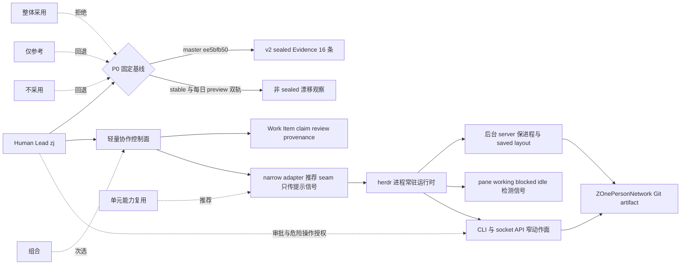
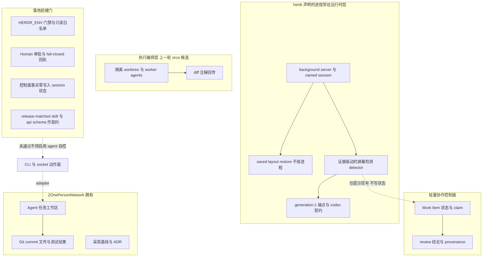
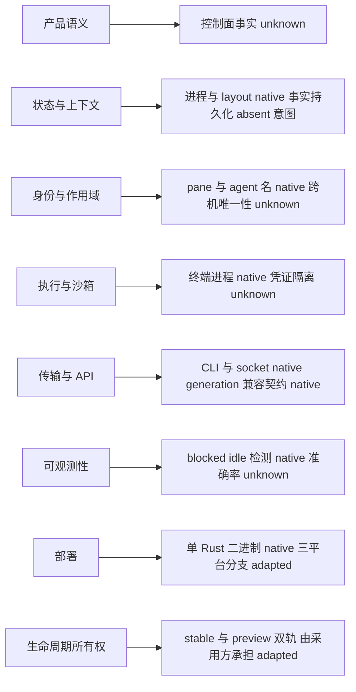

# 调研主题
herdrdev/herdr 在 ZOnePersonNetwork 的采用决策：进程常驻运行时、单元能力复用还是整体工作台

基于 commit ee5bfb50 的 16 条 sealed Evidence，herdr 声明的是 coding agent 的终端常驻运行时：detach 后后台 server 保进程、机器重启只恢复 saved layout、pane 标记 working/blocked/idle、agent 可通过 CLI 与 socket API 互相 prompt 与等待、兼容任意 CLI agent 但不包装它们、单 Rust 二进制分发。仓库级 AGENTS.md 另外固定了状态与运行时分离、server-owned runtime 迁移方向、generation-1 端点不可变契约、证据驱动的屏幕检测，以及 docs/next 草稿 / preview CI / versions 发布文档三层治理。sealed 范围内没有 Work Item、claim、review 或 provenance 的所有权声明，这类协作控制面语义是 unknown 而非 absent；屏幕检测出的 idle/blocked 是推断信号，不能升级成声明式任务事实。结论：有条件采用单元能力复用，组合为次选，拒绝整体采用为默认运行时；不 fork、不启用 remote machine、不把非 sealed 草稿当契约。

## 输入材料与观察时间
Evidence ledger: `49c5100c8d8a0fd80c20ca3650f515d562000f6927a5617c6335c186d3b31c51`
Observed: 2026-11-08T02:54:23.834Z

## Key-Value 概念索引
- Key: `decision-frame` — zj 只给了仓库 URL 与输出目录，未给决策问题；本报告沿用前两轮语境，按 alignment 假设其 job 是评估 herdr 作为 ZOnePersonNetwork 的常驻终端运行时层。基线是近似空仓库加人工搬运上下文，前两轮候选分别是 ZAgenticOPN 协作控制面（pin 2ff40cc）与 orca 执行编排工作台（pin 4f06ffd6）。若真实目标是替换控制面或编排层，选项排序需重做。
- Key: `three-layer-fit-model` — 协作控制面持有 Work Item / claim / review / provenance 事实；执行编排层持有 worktree 隔离、coordinator/worker 拆分与 diff 注解；herdr 落在第三层，持有终端进程常驻、saved layout、pane 状态可观测与 CLI/socket 动作面。三层不互相替代，混层就是语义错配。
- Key: `ownership-model` — herdr 明确声明 it owns their terminals，不包装也不替换 agent CLI。集成后由 ZOnePersonNetwork 侧持有控制面事实与 Git artifact，由 herdr 运行时持有进程与 pane 拓扑；Human 持有方向、审批、基线、凭证与危险操作授权。narrow adapter 只能单向传递提示信号，不得反向写入控制面状态。
- Key: `detected-state-vs-declared-fact` — sealed Evidence 只证明 pane 被标记 working/blocked/idle，且状态检测是读屏幕快照、以显式 AND/OR 门编码的证据驱动识别。它证明的是「可观测的推断信号」，不是「由控制面声明并可由 Human 裁决的任务事实」。把 idle/done 自动转成 claim/review 是本次决策要防的首要错配，标 unknown 而非 absent。
- Key: `persistence-layers` — detach/reattach 时原进程不停；server 或机器重启后原进程不存活，只恢复 saved layout 与可选 native agent session restore；再往上还有 session.json 备份/快照（非 sealed）与协作控制面事实。进程持久化 ≠ 布局持久化 ≠ 事实持久化，任何把控制面事实写进 session 状态的设计都拒绝。
- Key: `contract-source-of-truth` — AGENTS.md 固定 docs/next 是 committed drafts 且 never production website input、docs/preview 由 CI 原子提交、docs/versions 才是发布文档；skills/herdr/SKILL.md 跟随最新 stable release 并随 Cargo.toml version bump 更新。因此 master 上的 .mdx 与 skill 草稿不是稳定契约，落地前必须改用 release-matched herdr --skill 与 herdr api schema。
- Key: `evidence-strength-model` — 能力结论只认 16 条 commit-pinned sealed Evidence ID。native 表示 sealed 证明项目提供该能力；adapted 表示需要指定 adapter；absent 只用于主要来源明确否认；unknown 用于本轮证据不足。非 sealed 一手阅读只用于风险、所有权成本与验证门，不进入 critical claims。unknownCriteria 为空不代表证据充分。
- Key: `popularity-separation` — stars=49141、topicMatch=0 是 sealed ledger 原值，origin=explicit；49k stars / 3.9k forks / 20 topics 是仓库元数据。它们既不是能力覆盖分数，也不是语义契合或所有权成本的分数，不参与选项排序。
- Key: `lifecycle-stage` — experience-version：一个可丢弃的同设备双 Agent 纵向切片，成功条件是可观测、Human 门不绕过、控制面事实不迁移。HA / RBAC / SLO / 多用户 / 生产凭证 / 灾备 / 正式 rollout 与 rollback 明确推迟，dogfood/release 才需要的 versionSkew 字段按约定省略。
- Key: `runtime-deviation-status` — 本轮使用 pinned compiler research/v1 直接采集，herdr recursive tree 3,586 项未触发 orca 那轮的 listTree 缺陷；没有修复副本、没有 ZJ_RESEARCH_CLI 指针、没有旧账本或合成账本。采集偏差仅来自 brief 设计：v1 的 2 条路径子串 keyword 造成语义错配，v2 通过隔离导航 keyword 重建，负检查已确认 v1 fingerprint 与错配 Evidence ID 不能用于本轮 Report IR。

Concepts: [[decision-frame]], [[three-layer-fit-model]], [[ownership-model]], [[detected-state-vs-declared-fact]], [[persistence-layers]], [[contract-source-of-truth]], [[evidence-strength-model]], [[popularity-separation]], [[lifecycle-stage]], [[runtime-deviation-status]]

## C4 System Landscape
### 决策全景：用户、系统边界、五条选项与被选中的 seam

## 候选项目表
| Repository | Stars | Topic match |
|---|---:|---:|
| herdrdev/herdr | 49141 | 0 |

## 深读项目卡片
### herdrdev/herdr（唯一 serious candidate，pin ee5bfb50）
角色：coding agent 的终端常驻运行时与可观测层，不是 Work Item 控制面、也不是 worktree 编排工作台。最强能力：detach 后后台 server 保进程与重启后恢复 saved layout、pane 级 working/blocked/idle 标记、agent 可通过 CLI 与 socket API spawn pane / 互相 prompt / 等待 blocked、兼容任意 CLI agent 但明确只 owns 终端、单 Rust 二进制无 Electron；仓库级契约还固定了状态与运行时分离、server-owned runtime 迁移方向、generation-1 端点不可变与证据驱动的屏幕检测。主要缺口：sealed Evidence 只覆盖 README.md 9 条、AGENTS.md 6 条、Cargo.toml 1 条，实现行为、socket 权限、检测准确率、跨机器幂等与 Human 门 fail-closed 均为 unverified；Work Item / claim / review 语义在 sealed 范围内 unknown 而非 absent；docs/next 是未发布草稿；上游关闭 unsolicited PR。证据强度：16 条 canonical Evidence、3 个文件、unknownCriteria 为空但覆盖集中，属于「产品与工程契约清晰、落地前必须补实现层证据」级别。stars=49141 / topicMatch=0 为 sealed 原值，不作能力信号。

- Claim `c-position`
- Claim `c-detach`
- Claim `c-multi-machine`
- Claim `c-pane-state`
- Claim `c-agent-control`
- Claim `c-agent-compat`
- Claim `c-single-binary`
- Claim `c-install`
- Claim `c-license`
- Claim `c-docs-governance`
- Claim `c-skill-release`
- Claim `c-state-runtime`
- Claim `c-server-boundary`
- Claim `c-endpoint-contract`
- Claim `c-detection-evidence`
- Claim `c-manifest`
- Claim `c-semantic-layering`
- Claim `c-detected-vs-declared`
- Claim `c-control-plane-unknown`
- Claim `c-security-unknown`
- Claim `c-ownership-inherited`
- Claim `c-baseline-contract`
- Claim `c-evidence-coverage`

## 方案族及适用场景对比
### cmp-role-families
角色族：协作控制面是事实层（Work Item / claim / review / provenance）；执行编排层是工作区层（worktree 隔离、coordinator/worker、diff 注解）；herdr 是运行时层（进程常驻、saved layout、pane 状态检测、CLI/socket 动作面）；ZOnePersonNetwork 是消费工作区与 Git artifact；Human 是治理面。sealed 证据只证明第三族的产品与工程契约声明，第一族的所有权在 sealed 范围内保持 unknown。

Claims: `c-position`, `c-agent-compat`, `c-semantic-layering`, `c-control-plane-unknown`

### cmp-whole-product
约束 ownership-cost 与 lifecycle → 选项「整体采用为默认常驻运行时」→ 证据：单 Rust 二进制自带 server/session/socket、三平台安装脚本、server-owned runtime 迁移、generation-1 端点契约、docs 三层发布治理与 ghostty-vt workspace → tradeoff：一次继承跨平台分支、stable 与每日 preview 双轨、端点版本偏斜、上游关闭 unsolicited PR，而控制面语义仍是 unknown → decision：拒绝。49,141 stars 不构成抵消这些所有权成本的证据。

Claims: `c-single-binary`, `c-install`, `c-server-boundary`, `c-endpoint-contract`, `c-docs-governance`, `c-ownership-inherited`, `c-control-plane-unknown`

### cmp-unit-capability
约束 layer 与 evidence → 选项「单元能力复用」→ 证据：detach/restart 的分层持久化、证据驱动的 blocked 检测、CLI+socket 窄动作面、generation-1 端点不可变契约、状态与运行时分离 → tradeoff：得到四类可分离设计而不内化整个二进制；但检测语义与端点混合版本行为仍需实测 → decision：推荐（有条件）。复用的是设计与接口契约，不是把 3,112 blob 仓库搬进来。

Claims: `c-detach`, `c-detection-evidence`, `c-agent-control`, `c-endpoint-contract`, `c-state-runtime`, `c-detected-vs-declared`

### cmp-hybrid
约束 runtime-state-semantics 与 persistence → 选项「组合：herdr 承担运行时 + 轻量控制面持有事实 + narrow adapter」→ 证据：herdr owns terminals 而不 owns Work Item，detach 保进程但重启不保进程 → tradeoff：能拿到常驻与可观测价值，代价是必须写并维护一个只传提示信号、不写控制面状态的 adapter，还要为每个信号定义 Human 确认点 → decision：次选，仅当 P2 切片证明 adapter 不被绕过时启用。

Claims: `c-agent-compat`, `c-detach`, `c-pane-state`, `c-control-plane-unknown`, `c-detected-vs-declared`

### cmp-reference-only
约束 canonical-coverage 与 security → 选项「仅作设计参考」→ 证据：16 条 Evidence 只覆盖 3 个声明层文件，实现/权限/检测准确率均 unverified → tradeoff：零集成成本、零运行时所有权，但拿不到 detach 常驻与 blocked 可观测的实际收益 → decision：作为验证门不过或对齐项被推翻时的回退路径。

Claims: `c-evidence-coverage`, `c-security-unknown`, `c-detection-evidence`

### cmp-no-adoption
约束 lifecycle 与 popularity → 选项「不采用，维持人工交接」→ 证据：基线失败模式是会话中断与逐个终端巡检，而 herdr 的产品声明正对这两点；但 unknown 的实现层证据与上游治理成本尚未闭合 → tradeoff：不做错决策，也不改善基线 → decision：作为安全门或基线漂移未收敛时的明确回退，不是默认结论。

Claims: `c-position`, `c-detach`, `c-pane-state`, `c-security-unknown`, `c-ownership-inherited`

### cmp-baseline
基线对照：今天 Human 靠人工搬运上下文、逐个终端巡检；目标切片要求 detach 后进程仍在、blocked 信号可见、结果带 provenance。比较指标必须是 preserved_process_detach_rate、blocked_signal_recall、provenance_completeness 与 Human 审批覆盖率，而不是 stars、README 长度或 feature 数量。

Claims: `c-detach`, `c-pane-state`, `c-agent-control`, `c-position`

### cmp-capability-matrix
能力组合矩阵（owner 在集成后）：产品语义 unknown→由控制面持有；状态/上下文 native（进程与 layout）但事实持久化 absent 意图→由控制面持有；身份/作用域 native（pane 与 agent 名）但跨机唯一性 unknown→adapter 需加 server 前缀；执行/沙箱 native（终端进程）但凭证隔离 unknown→Human 门；传输/API native（CLI 与 socket）+ generation 契约 native→adapter 只读；可观测性 native（检测信号）但准确率 unknown→只作提示；部署 native（单二进制）→整体采用时由采用方承担；生命周期所有权 adapted（stable + preview + 端点代际）→ADR 固定基线。每个格子都必须标 native / adapted / absent / unknown，unknown 不得写成 absent。

Claims: `c-semantic-layering`, `c-detach`, `c-multi-machine`, `c-agent-control`, `c-endpoint-contract`, `c-detection-evidence`, `c-single-binary`, `c-ownership-inherited`, `c-control-plane-unknown`

### cmp-detected-vs-declared
语义错配：约束 runtime-state-semantics → 证据是屏幕快照上的 AND/OR 门识别与 pane 标记 → tradeoff 是若把 idle/blocked 直接写成控制面状态迁移，会在审批弹窗未被识别或后台任务仍在跑时提前推进 Work Item → decision：adapter 只允许单向传提示信号，任何 claim/review 状态迁移必须由 Human 显式确认，检测准确率在 P2 中用固定 fixture 实测。

Claims: `c-detected-vs-declared`, `c-detection-evidence`, `c-pane-state`, `c-control-plane-unknown`

### cmp-security
安全主题（执行模型生成代码必须覆盖）：credentials 由 SSH 认证与安装脚本面引入→Human 完成认证、agent 不得代劳；approvals 由 blocked 信号触发→Human 显式授权；dangerous operations 由 mutating CLI/socket 命令构成→只读白名单 + 逐次授权 + fail-closed 回执；isolation 由 HERDR_ENV 门禁与单 server ID 空间构成→不启用 saved SSH machine；provenance 要求结果带 commit 与测试证据而不只靠 pane 输出；recovery 要求断连后先 inspect remote state 再重试、session 备份不自动恢复。sealed 范围对以上机制没有 canonical Evidence，全部列为验证门而非已具备能力。

Claims: `c-agent-control`, `c-install`, `c-security-unknown`, `c-pane-state`, `c-detach`, `c-detected-vs-declared`

### cmp-evidence-gaps
证据缺口与迭代：v1 brief 把 README.md 与 Cargo.toml 当作 criterion keyword，路径子串在 AGENTS.md 正文里被当成内容 keyword，导致 product-position 与 manifest-scope 两条 Evidence 错配到文档治理段；v2 把导航 keyword 隔离到语义本就在 AGENTS.md 的两个 criterion，其余 14 个只用正文短语，16 条全部语义对齐。负检查确认 v1 与 v2 的 briefFingerprint 不同、两条错配 Evidence ID 不在 v2 中，因此 findings 与 Report IR 从 v2 完整重建，而不是只替换指纹。unknownCriteria 为空仍不等于证据充分。

Claims: `c-evidence-coverage`, `c-baseline-contract`, `c-docs-governance`

### cmp-upstream-governance
所有权风险：CONTRIBUTING.md（非 sealed）明确自动关闭非 maintainer / 非 APPROVED_CONTRIBUTORS 的实现 PR，理由是维护者无法验证外部 agent 的上下文、模型、prompt 与人类监督。约束 upstream-governance → tradeoff 是缺陷修复与定制不能依赖 upstream 合并 → decision：不 fork 源码；如必须 patch，先按 fork 成本核算、pin 到 release tag，并在 ADR 里写明不再预期回到上游。

Claims: `c-ownership-inherited`, `c-baseline-contract`, `c-evidence-coverage`

### cmp-version-contract
版本与契约：generation 1 是 Local / SSH / Cloud 兼容底线、codec 不可变、新字段必须 optional，但 sealed 证据没有给出混合版本实测结果；docs/next 草稿、preview CI 快照、stable release 文档与 release-matched skill 是四条不同的事实来源。约束 baseline → decision：ADR 固定 source_commit 与 release version，以 herdr --skill 与 herdr api schema 为契约来源；基线变化时按新 fingerprint 重建 findings 与 Report IR。按 Experience Version 定深，不写 dogfood/release 的 versionSkew 承诺。

Claims: `c-endpoint-contract`, `c-baseline-contract`, `c-docs-governance`, `c-skill-release`

### cmp-popularity
热度分离：stars=49141 与 topicMatch=0 来自 sealed ledger，49k stars / 3.9k forks / 20 topics 来自仓库元数据。它们描述关注度与主题命中，不描述状态检测准确率、端点兼容、凭证隔离或所有权成本，因此不参与五条选项的排序，也不用来抵消 cmp-whole-product 里的成本。

Claims: `c-position`, `c-ownership-inherited`, `c-evidence-coverage`

## C4 Context/Container 与子主题图
### 容器与所有权：运行时层、控制面、执行编排层与落地前硬门

### 能力组合矩阵：产品语义到生命周期所有权的 native / adapted / absent / unknown

## 关键技术指标矩阵
| Metric | Definition | Unit | Method | Condition | Expected |
|---|---|---|---|---|---|
| preserved_process_detach_rate | 客户端 detach 并 reattach 后原 agent 进程仍存活的运行占比 | % | P2 切片中记录 pane PID 与 agent 进程身份，reattach 后比对是否为同一进程 | 连续 3 次 detach/reattach，含一次 SSH 断连模拟 | 100% |
| blocked_signal_recall | 预设 approval / question UI 场景中被正确标记为 blocked 并由 Human 看到提示的比例 | % | 用固定 fixture 构造 N 个已知阻塞场景，比对检测输出与 Human 提示日志 | P2 的 blocked fixture 集合，覆盖至少 2 种 agent CLI | >= 95% |
| detected_state_latency_p95 | 从 agent 进入阻塞状态到 pane 标记可见的耗时 95 分位 | 秒 | 在 fixture 中打注入时间戳与检测事件时间戳，计算差值分布 | P2 全部 blocked 事件 | <= 5s |
| detected_state_misuse_count | 把 idle / done / unknown 检测信号直接转成控制面 claim 或 review 状态迁移的次数 | 次 | 审计 adapter 出站消息与控制面状态迁移日志，按 signal_id 关联 | 每次切片运行与每次 Human 审批窗口都统计 | 0 |
| human_approval_coverage | mutating CLI/socket 动作中具有 Human 显式授权记录的比例 | % | 比对动作审计日志与授权回执，逐条检查授权者、时间与动作 id | P1 安全门与 P2 切片全部动作 | 100% |
| credential_exposure_events | 凭证、SSH 认证令牌或安装脚本执行上下文出现在 agent 可读 pane 输出或日志中的次数 | 次 | clean-room 中扫描 pane 输出、日志与环境变量快照，匹配凭证模式 | P1 与 P2 全过程 | 0 |
| control_plane_facts_in_session_state | Work Item / claim / review 事实被写入 session.json、layout snapshot 或 runtime 状态的次数 | 次 | 对运行时状态文件做字段白名单检查，并比对控制面事实 id 集合 | P2 每次 detach、restart 与恢复之后 | 0 |
| provenance_completeness | 回传结果同时带 source_commit、变更文件集合与测试证据的比例 | % | 对每次 adapter 回传做必需字段校验并记录缺失字段 | 连续 3 次双 Agent 任务 | 100% |
| adapter_seam_bypass_rate | herdr 运行时直接写控制面状态或控制面直接驱动 mutating CLI 的动作占比 | % | 按调用栈与审计日志统计跨层直接调用次数，除以总跨层动作数 | P2 与 P3 全部跨层动作 | 0% |
| release_contract_mismatch | 以 docs/next 草稿或 master SKILL.md 作为契约来源、而非 release-matched skill / api schema 的次数 | 次 | 把 adapter 引用的契约文件与 ADR 固定来源逐条比对 | P0 基线固定后每次契约更新 | 0 |
| version_baseline_drift | 实测二进制版本、skill 版本与 ADR 固定的 source_commit / release version 不一致的次数 | 次 | 用 herdr --version、herdr --skill 与 api schema 输出比对 ADR 记录 | 每次安装、升级与重采之前 | 0 |
| baseline_inspection_saving | 双 Agent 任务中 Human 巡检终端与搬运上下文耗时相对人工基线的下降比例 | % | 同一任务集分别在基线与切片下计时，取 3 次重复的中位数 | usefulness-validation 阶段的同构任务集 | >= 50% 且 3 次方向一致 |

## 建议、限制与待验证事项
### rec-primary
总选择：有条件采用「单元能力复用」，以「组合」为次选，拒绝把 herdr 整体作为 ZOnePersonNetwork 的默认常驻运行时。只吸收四类可分离设计——detach 保进程与重启恢复 layout 的分层持久化、证据驱动的 blocked 屏幕检测、CLI+socket 窄动作面、generation-1 端点不可变契约与状态/运行时分离原则；用 narrow adapter 把提示信号接到轻量协作控制面，Work Item / claim / review / provenance 事实不迁移。条件一：zj 先固定 source_commit ee5bfb50 与 release version，并用 release-matched herdr --skill 与 herdr api schema 作契约来源；条件二：凭证、审批、危险操作、隔离、provenance 与恢复必须由 clean-room 实测补齐；条件三：验证门不过则退回仅参考或不采用。结论以 v2 sealed commit 为界，不把非 sealed 一手阅读写成已验证能力。

Comparisons: `cmp-role-families`, `cmp-whole-product`, `cmp-unit-capability`, `cmp-hybrid`, `cmp-baseline`, `cmp-evidence-gaps`

### rec-constraint-table
约束→选择表（prose）：layer → 控制面事实不迁进运行时层，herdr 只作第三层；runtime-state-semantics → 检测信号只作提示，idle/blocked 不得自动触发 claim/review 状态迁移；persistence → 进程与 layout 由运行时恢复，事实由控制面独立存储，session 状态零写入；evidence → 能力结论只引用 16 条 v2 sealed Evidence，非 sealed 事实只作风险与验证对象；canonical-coverage → .mdx / SKILL.md / CONTRIBUTING.md 单独走 primary-source reading，不冒充 sealed；security → HERDR_ENV 门禁、只读白名单、Human 审批与 fail-closed 回执；lifecycle → 只做可丢弃切片，不写 HA/RBAC/SLO/多用户；ownership-cost → 不 fork 3,112 blob 仓库、不启用 saved SSH machine 与生产凭证；upstream-governance → 不预期 upstream 合并缺陷修复；baseline → 固定 commit 与 release、跨轮指纹不混用；popularity → stars 与 topicMatch 不参与排序。

Comparisons: `cmp-role-families`, `cmp-capability-matrix`, `cmp-detected-vs-declared`, `cmp-security`, `cmp-version-contract`, `cmp-popularity`

### rec-phased-path
分阶段落地：P0 固定基线——把 commit ee5bfb50、release 0.9.5、v2 briefFingerprint 与两层运行时/控制面边界写进 ADR，取 release-matched skill 与 api schema，明确不引用 docs/next 草稿。P1 clean-room 安全门——在隔离环境验证 HERDR_ENV 门禁、只读命令白名单、mutating 命令逐次 Human 授权、SSH 认证不由 agent 代做、setup 默认 No、断连后 inspect-before-retry 与 fail-closed 回执；任何一项失败即停止。P2 同设备双 Agent 可丢弃切片——两个隔离 pane 并行执行，detach/reattach 后进程仍在，blocked 信号被 Human 看见并显式授权，结果以 provenance 回传；统计 preserved_process_detach_rate、blocked_signal_recall、detected_state_misuse_count、human_approval_coverage 与 credential_exposure_events。P3 判定——指标达阈值且 adapter_seam_bypass_rate=0、control_plane_facts_in_session_state=0 才允许进入 usefulness-validation；否则退回仅参考或不采用。全过程不安装到 zj 本机生产环境、不自动 commit 或 push。

Comparisons: `cmp-baseline`, `cmp-security`, `cmp-hybrid`, `cmp-version-contract`

### rec-avoid-paths
明确避免的路径：① 把 working/blocked/idle 或 done 直接写成控制面状态迁移（语义错配，见 cmp-detected-vs-declared）；② 把 docs/next 的 .mdx 或 master 上的 SKILL.md 当稳定集成契约（F10/F11 已说明它们是草稿或随 release 变动）；③ 让 agent 代做 SSH 认证、跨机器 machine add 或在连接失败后盲目重试 mutating 命令；④ 把 session.json / snapshot 当控制面事实存储；⑤ 因 49k stars 或 unknownCriteria 为空就跳过实现层验证；⑥ 为了修一个缺陷而 fork 并长期维护整个 Rust workspace 却不记录基线。以上每条都有对应的拒绝约束，不是风格建议。

Comparisons: `cmp-detected-vs-declared`, `cmp-version-contract`, `cmp-security`, `cmp-upstream-governance`, `cmp-evidence-gaps`, `cmp-popularity`

### rec-graduation-and-validation
阶段退出条件复述（graduationCriteria 字段由质量门校验但不被共享编译器渲染）：G1 固定基线后 clean-room 安装与安全门全通过，阈值 preserved_process_detach_rate=100%、human_approval_coverage=100%、credential_exposure_events=0，promoteTo=usefulness-validation；G2 双 Agent 切片的检测信号不越权，阈值 detected_state_misuse_count=0、blocked_signal_recall>=95%、detected_state_latency_p95<=5s，promoteTo=usefulness-validation；G3 事实边界与 provenance 在连续 3 次重复实验中保持完整，阈值 control_plane_facts_in_session_state=0、provenance_completeness=100%、adapter_seam_bypass_rate=0%，promoteTo=dogfood；G4 与人工基线对照有稳定增益，阈值 巡检耗时下降>=50% 且 3 次重复实验方向一致、无新增未授权 mutation，promoteTo=dogfood；G5 契约来源与基线一致率达标，阈值 release_contract_mismatch=0、version_baseline_drift=0，作为 release 前的最后一道门。每个重要 claim 都映射到验证场景：F2 detach/restart 分层→P2 detach 与 kill server 两次观测；F4/F15 检测→固定 fixture 的 blocked 召回与 idle 误判；F14 端点契约→两代二进制混合连接；F5 动作面→只读白名单与 mutating 授权回执。

Comparisons: `cmp-baseline`, `cmp-security`, `cmp-capability-matrix`, `cmp-version-contract`

### rec-remaining-risks
存活风险复述（riskRegister 字段由质量门校验但不被共享编译器渲染）：① 屏幕检测状态被当成声明式任务事实 → adapter 只传提示 + Human 显式确认，残留是检测准确率仍待实测，owner=zj；② 进程持久化被当成事实持久化 → 控制面事实独立存储并断言 session 状态零写入，残留是恢复实验尚未跑，owner=Research report owner；③ agent 自控 CLI/socket 越过 Human 门 → HERDR_ENV 门禁 + 只读白名单 + 逐次授权 + fail-closed 回执，残留是白名单覆盖不全，owner=zj；④ saved SSH machine 断连重试造成重复 mutation → 切片内禁用 machine 面，如启用必须 inspect-before-retry 与幂等键，残留是跨机幂等未验证，owner=Integration owner；⑤ canonical 覆盖限制使草稿被当契约、healthy receipt 被误读为实现层已验证 → findings 与 ADR 固定 sealed 边界与 3 文件分布，用 release-matched schema/skill 作契约，残留是非 sealed 内容需要人工复核，owner=Research report owner；⑥ 上游 PR gate 封闭导致缺陷无法 upstream → pin release tag 且不依赖合并，残留是必须 patch 时只能 fork，owner=zj；⑦ stable 与每日 preview 双轨及 generation 混合版本偏斜 → ADR 固定 commit 与 release、基线变化按新 fingerprint 重建 IR，残留是上游持续发版使固定基线落后，owner=zj；⑧ 对齐项：zj 真实决策问题未确认，若目标不是运行时层选型，报告选项排序需重做，owner=zj。

Comparisons: `cmp-role-families`, `cmp-detected-vs-declared`, `cmp-security`, `cmp-evidence-gaps`, `cmp-upstream-governance`, `cmp-version-contract`, `cmp-whole-product`

## 来源清单
- [herdrdev/herdr@ee5bfb5041bb3e4a49d591c72308aae3c81ecdde:AGENTS.md](https://github.com/herdrdev/herdr/blob/ee5bfb5041bb3e4a49d591c72308aae3c81ecdde/AGENTS.md) — Evidence `6965f9991cffb4f28ee08f14`
- [herdrdev/herdr@ee5bfb5041bb3e4a49d591c72308aae3c81ecdde:AGENTS.md](https://github.com/herdrdev/herdr/blob/ee5bfb5041bb3e4a49d591c72308aae3c81ecdde/AGENTS.md) — Evidence `ffe7879a993380564295355d`
- [herdrdev/herdr@ee5bfb5041bb3e4a49d591c72308aae3c81ecdde:AGENTS.md](https://github.com/herdrdev/herdr/blob/ee5bfb5041bb3e4a49d591c72308aae3c81ecdde/AGENTS.md) — Evidence `96de34e84950a4b0c05ef927`
- [herdrdev/herdr@ee5bfb5041bb3e4a49d591c72308aae3c81ecdde:AGENTS.md](https://github.com/herdrdev/herdr/blob/ee5bfb5041bb3e4a49d591c72308aae3c81ecdde/AGENTS.md) — Evidence `4e2792d94dc3f81c170c6368`
- [herdrdev/herdr@ee5bfb5041bb3e4a49d591c72308aae3c81ecdde:AGENTS.md](https://github.com/herdrdev/herdr/blob/ee5bfb5041bb3e4a49d591c72308aae3c81ecdde/AGENTS.md) — Evidence `43a2fb182ecb9f6306f7c1d5`
- [herdrdev/herdr@ee5bfb5041bb3e4a49d591c72308aae3c81ecdde:AGENTS.md](https://github.com/herdrdev/herdr/blob/ee5bfb5041bb3e4a49d591c72308aae3c81ecdde/AGENTS.md) — Evidence `7f5eae80cae7a1a16ebadf0e`
- [herdrdev/herdr@ee5bfb5041bb3e4a49d591c72308aae3c81ecdde:Cargo.toml](https://github.com/herdrdev/herdr/blob/ee5bfb5041bb3e4a49d591c72308aae3c81ecdde/Cargo.toml) — Evidence `ca1d50cb753ed7b8ed717692`
- [herdrdev/herdr@ee5bfb5041bb3e4a49d591c72308aae3c81ecdde:README.md](https://github.com/herdrdev/herdr/blob/ee5bfb5041bb3e4a49d591c72308aae3c81ecdde/README.md) — Evidence `47182a0e1869703551a60363`
- [herdrdev/herdr@ee5bfb5041bb3e4a49d591c72308aae3c81ecdde:README.md](https://github.com/herdrdev/herdr/blob/ee5bfb5041bb3e4a49d591c72308aae3c81ecdde/README.md) — Evidence `8108ad662e318f347dfb172f`
- [herdrdev/herdr@ee5bfb5041bb3e4a49d591c72308aae3c81ecdde:README.md](https://github.com/herdrdev/herdr/blob/ee5bfb5041bb3e4a49d591c72308aae3c81ecdde/README.md) — Evidence `daac3c9036fb77b32c5b40bf`
- [herdrdev/herdr@ee5bfb5041bb3e4a49d591c72308aae3c81ecdde:README.md](https://github.com/herdrdev/herdr/blob/ee5bfb5041bb3e4a49d591c72308aae3c81ecdde/README.md) — Evidence `be630dc8ed685d364a63d139`
- [herdrdev/herdr@ee5bfb5041bb3e4a49d591c72308aae3c81ecdde:README.md](https://github.com/herdrdev/herdr/blob/ee5bfb5041bb3e4a49d591c72308aae3c81ecdde/README.md) — Evidence `e3545bea44fa352f51b5393e`
- [herdrdev/herdr@ee5bfb5041bb3e4a49d591c72308aae3c81ecdde:README.md](https://github.com/herdrdev/herdr/blob/ee5bfb5041bb3e4a49d591c72308aae3c81ecdde/README.md) — Evidence `905629f76105cc74192dc7ba`
- [herdrdev/herdr@ee5bfb5041bb3e4a49d591c72308aae3c81ecdde:README.md](https://github.com/herdrdev/herdr/blob/ee5bfb5041bb3e4a49d591c72308aae3c81ecdde/README.md) — Evidence `1590f5d5483d72a8fcdeaee5`
- [herdrdev/herdr@ee5bfb5041bb3e4a49d591c72308aae3c81ecdde:README.md](https://github.com/herdrdev/herdr/blob/ee5bfb5041bb3e4a49d591c72308aae3c81ecdde/README.md) — Evidence `90e06efa6fd8bbd7d30dfa16`
- [herdrdev/herdr@ee5bfb5041bb3e4a49d591c72308aae3c81ecdde:README.md](https://github.com/herdrdev/herdr/blob/ee5bfb5041bb3e4a49d591c72308aae3c81ecdde/README.md) — Evidence `db7c63d496c04cafa094576f`
