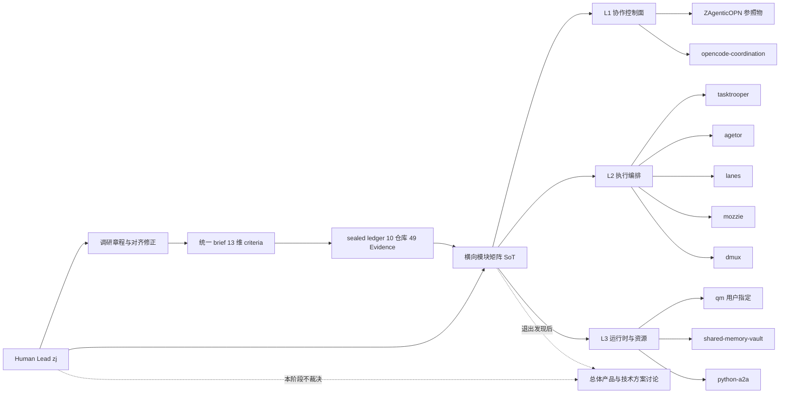
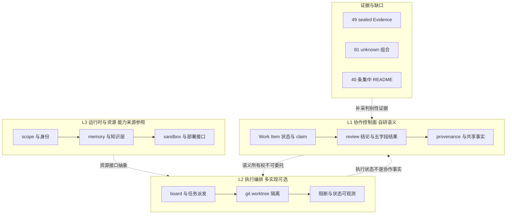
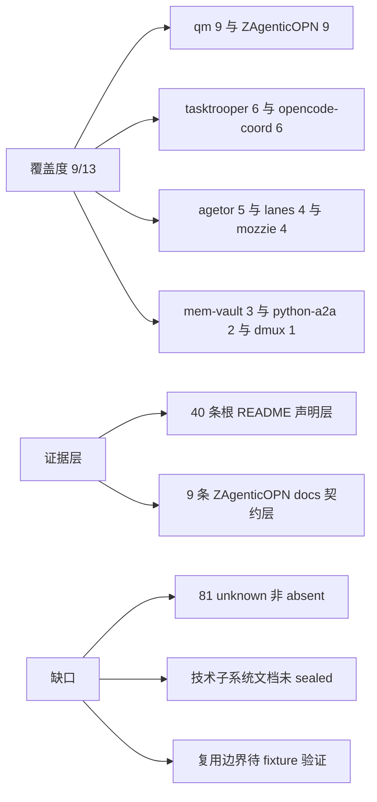

# 调研主题
个人即协同网络：10 个候选项目的横向产品/技术模块地图（Problem discovery）

为重新开发「个人即协同网络」做前置调研，对 10 个 commit-pinned 开源项目用同一套 13 维模块 criteria 采集，得到 49 条 sealed Evidence 与 81 个显式 unknown。结论不是采用排序，而是一张模块地图：没有任何单一项目覆盖 13 个维度（最高 9/13），这类产品天然跨三层——协作控制面（Work Item / claim / review / provenance 语义）、执行编排（board 与 git worktree 隔离）、运行时与资源（scope / memory / sandbox / 部署与接口抽象）。qm 强在第三层、ZAgenticOPN 强在第一层，两者互补而非替代；任务板、worktree 隔离、可观测有多个现成实现，而身份与 scope、共享事实边界、Human 门统一语义各家定义互不相容，必须自研语义 —— 这才是「大多数内容从 0 到 1」的真实落点。referenced capability-map 已把 qm 列为能力来源参照，本轮证据与其方向一致。推荐下一步先补采判别性证据压低 81 个 unknown，再进入总体方案讨论；本阶段不裁决架构、不写方案、不实现。

## 输入材料与观察时间
Evidence ledger: `b4367c64557fe12337effb03ed60298f8a6d48451a4f877f34b542d8b0dfc4a8`
Observed: 2026-11-08T03:55:00.776Z

## Key-Value 概念索引
- Key: `decision-frame` — Problem discovery，只调研多个类似项目的产品设计和技术设计，为之后的总体产品方案与技术方案讨论准备素材。前三轮「某项目在 ZOnePersonNetwork 的采用形态」框架已作废，其结论层不沿用，事实层仅作素材。对齐项：沿用 charter 假设——单人 owner、可能跨设备与多项目、以 ZAgenticOPN 为参照物。
- Key: `module-map` — 统一 brief 用 13 个维度覆盖 charter 的 10 个草案模块加技术设计、Agent 间协议与参照物能力地图：任务与工作项、身份与 scope、会话上下文、执行与工作区、审批与人工介入、结果与产物、知识与记忆、可观测、配置与策略、运行时与集成、Agent 间协议、技术设计、参照物能力地图。同一套 criteria 用于全部 10 个仓库，产出横向矩阵而非 N 份单项目采用决策报告。
- Key: `three-layer-fit` — L1 协作控制面持有 Work Item 状态、claim 权限、review 结论、provenance 与共享事实；L2 执行编排持有 board 流转、git worktree 隔离、并行与状态可观测；L3 运行时与资源持有 scope、memory、权限、沙箱、skills、部署与接口抽象。现有项目各做一到两层，概念跨三层正是「模块构成不清晰」的根源。
- Key: `coverage-finding` — 49 条 Evidence / 130 个仓库×维度组合，覆盖度 qm 9/13、ZAgenticOPN 9/13、tasktrooper 6/13、opencode-coord 6/13、agetor 5/13、lanes 4/13、mozzie 4/13、mem-vault 3/13、python-a2a 2/13、dmux 1/13。没有任何单一项目覆盖全部维度，照搬任一项目的模块划分都会漏格。
- Key: `reuse-locus` — 0→1 工作量不集中在任务板、worktree 隔离、可观测这些有多个现成实现的模块，而集中在语义所有权层：身份与 scope 定义、共享事实边界、Human 门统一语义、跨模块 provenance。这些格子虽有 sealed 声明，但各家定义互不相容，无法直接复用，只能重新定义语义后再挑实现。
- Key: `human-boundary` — 四种冲突表达：tasktrooper「You don't drive the agents, the board does」自动派发；ZAgenticOPN Human action script 只处理例外；qm Strict/Auto/Dangerous 三姿态、严格模式逐工具审批；mozzie approve-to-push / reject-with-feedback。未裁决就交给 Coding Agent，会在派发与审批细节里反复返工，这是「困在细节里」的具体机制。
- Key: `reference-loop` — ZAgenticOPN 的 selective-reuse capability-map 已把 qm 列为 qm（ref），列出可抽取的 ClaimStore/delivery drain claim、TaskStore CAS、scope-authorized memory、revision/restore、session recovery，并写明不能替代 Work Item authority 或 shared coordination schema。本轮 qm sealed 证据与其方向一致；该闭环是分析层推断，仍需契约 fixture 验证。
- Key: `evidence-strength` — 能力结论只认 49 条 commit-pinned sealed Evidence ID。native 表示 sealed 证明该仓库声明了该模块；adapted 表示需指定 adapter 或语义统一；absent 只用于主要来源明确否认，本轮未使用；unknown 表示本轮统一短语未命中，81 个组合全部显式保留。非 sealed 一手阅读只用于风险与验证门。
- Key: `unknown-discipline` — 81 个 unknown 是采集方法边界，不是项目能力缺失。例如 qm 在任务与执行模块标 unknown，但 README 里存在项目跟踪与 execute 沙箱段落；已在矩阵第 9 节给出判别性补采短语。unknownCriteria 为空也不代表证据充分，本轮它明确非空。
- Key: `lifecycle-stage` — Problem discovery。只产出模块地图、证据缺口、复用边界推断与分歧清单；不写总体产品方案/技术方案、不排名采用形态、不实现代码、不安装任何项目、不引入 HA/RBAC/SLO/生产凭证/灾备或 dogfood/release 版本偏斜义务。graduationCriteria 留空，发现阶段退出条件在 recommendations prose 中复述。

Concepts: [[decision-frame]], [[module-map]], [[three-layer-fit]], [[coverage-finding]], [[reuse-locus]], [[human-boundary]], [[reference-loop]], [[evidence-strength]], [[unknown-discipline]], [[lifecycle-stage]]

## C4 System Landscape
### 调研全景：用户、系统边界、三层模块与 10 个候选项目

## 候选项目表
| Repository | Stars | Topic match |
|---|---:|---:|
| yc-software/qm | 15655 | 0 |
| makifbaysal/tasktrooper | 120 | 0 |
| JF3Env/opencode-coordination | 0 | 4 |
| alamops/agetor | 123 | 0 |
| lanes-sh/app | 277 | 1 |
| usemozzie/mozzie | 48 | 1 |
| songs-aaa/shared-memory-vault | 100 | 0 |
| themanojdesai/python-a2a | 1010 | 0 |
| standardagents/dmux | 1816 | 0 |
| jununfly/ZAgenticOPN | 0 | 0 |

## 深读项目卡片
### yc-software/qm（用户指定，L3 运行时与资源层，9/13）
角色：多人组织的 multiplayer agent harness，不是 Work Item 控制面。最强能力：以 scope 为模块单位——每人每房各有 scoped memory、files、keychain view、permissions、crons、web apps 与 durable sandbox；Strict/Auto/Dangerous 三姿态与全量审计；Shared skills 与 deployment directory；central core + Postgres + 固定工具面 + 每 scope 隔离沙箱；每个 substrate 都在接口之后。主要缺口：任务与工作项、执行隔离、Agent 间协议三格本轮为 unknown（sealed 短语未命中，不是能力缺失），技术子系统文档未进入 sealed 范围。证据强度：9 条 canonical Evidence 全来自 README，属产品声明层清晰、实现层待补。stars=15655 / topicMatch=0 为 sealed 原值，不参与判断。

- Claim `c-qm-scope`
- Claim `c-qm-tech`
- Claim `c-qm-security`
- Claim `c-qm-observability`
- Claim `c-qm-config`
- Claim `c-coverage`
- Claim `c-three-layers`

### jununfly/ZAgenticOPN（参照物，L1 协作控制面，9/13）
角色：单人跨设备多 Agent 自服务协作的语义所有权定义，与 qm 同覆盖度但格子不同。最强能力：R1–R12 需求清单、Work Item eligibility / lifecycle / Claim authority、Result/review semantics、Human action script、Health scorecard、语义所有权表，以及明确「shared context 只存结构化事实与 canonical Git references」。capability-map 把 qm 列为能力来源参照并写明不能替代 Work Item authority。主要缺口：执行隔离、会话上下文、Agent 间协议、技术设计为 unknown；README 只有 687 字符，证据全来自 docs 文档。stars=0 / topicMatch=0 为 sealed 原值。

- Claim `c-zn-spec`
- Claim `c-zn-capmap`
- Claim `c-zn-deferred`
- Claim `c-reference-loop`
- Claim `c-divergence`
- Claim `c-coverage`
- Claim `c-three-layers`

### makifbaysal/tasktrooper（L2+L3，6/13）
角色：software teams of one 的本地优先 agent 平台，board + 角色 agents + runtime。最强能力：「You don't drive the agents, the board does」自动派发；四 scope 记忆与代码理解；embedded Postgres + Go 后端本地运行；产物与 Human 门由列角色流转。主要缺口：审批、结果 provenance、执行隔离、会话上下文为 unknown。证据强度：6 条 README Evidence。

- Claim `c-task-auto`
- Claim `c-task-memory`
- Claim `c-task-tech`
- Claim `c-divergence`
- Claim `c-coverage`

### JF3Env/opencode-coordination（L1+协议，6/13）
角色：append-only SQLite ledger 上的多 Agent 协作控制面。最强能力：Roles / work items / messages / progress / history 全在一个不可改账本上；九态 Work Item life cycle；typed messages with record ids；owner approvals 与 file overlap checks；角色绑定 agent identity。主要缺口：执行隔离、memory、技术设计为 unknown。stars=0 但 topicMatch=4、6 条 Evidence，说明热度与模块覆盖无关。

- Claim `c-occ-ledger`
- Claim `c-occ-protocol`
- Claim `c-occ-approval`
- Claim `c-divergence`
- Claim `c-popularity`

### alamops/agetor（L2 执行编排，5/13）
角色：local-first kanban harness，不替换 agent、不改 CLAUDE.md。最强能力：每个任务独立 git worktree；tmux 支撑 Restart-safe；通知与 Stay in the loop；One local API 只监听 127.0.0.1 并逐路由鉴权；无账号、无云 relay、无 telemetry。主要缺口：任务板语义、审批、provenance、memory 为 unknown。

- Claim `c-agetor-worktree`
- Claim `c-agetor-local`
- Claim `c-agetor-tech`
- Claim `c-coverage`

### lanes-sh/app（L2+L3，4/13）
角色：把每个 agent session 放到 issue board 上的原生 macOS 应用。最强能力：Each card is a task，每卡含 live terminal、独立 git worktree 与 diff；issues / worktrees / sessions / one board；apps、memory、skills 统一在 Lanes Link 端点；Local-first by default 用本机 SQLite，remote workspace opt-in。主要缺口：审批、provenance、可观测、技术设计为 unknown。

- Claim `c-lanes-board`
- Claim `c-lanes-local`
- Claim `c-coverage`

### usemozzie/mozzie（L2，4/13）
角色：本地优先桌面编排器，把目标拆成 work items 并交给 agent 群。最强能力：Create a work item → assign agent → play；isolated git worktrees 每 work item 独立分支；Review workflow 的 approve to push / reject with feedback，Agent 从拒绝历史学习；SQLite 本地库。主要缺口：memory、可观测、配置、运行时为 unknown。

- Claim `c-mozzie-workitem`
- Claim `c-mozzie-review`
- Claim `c-divergence`
- Claim `c-coverage`

### songs-aaa/shared-memory-vault（L3 知识层，3/13）
角色：纯 Markdown 的多 Agent 共享知识库治理引擎。最强能力：session-blackboard convention 用单个 CONTEXT.md 让任意 agent 接续；跨设备云同步目录、无数据库无服务无厂商锁定；single source of truth 与 timestamp + .bak 冲突处理；明确的 session lifecycle 与权限分层。主要缺口：任务、执行、审批、协议等 10 格 unknown，它是单一能力单元而非产品。

- Claim `c-memvault-markdown`
- Claim `c-memvault-session`
- Claim `c-three-layers`

### themanojdesai/python-a2a（协议层，2/13）
角色：Google A2A 协议与 MCP 集成的 Python 实现，不是产品。最强能力：A2A 标准通信格式使不同实现的 agent 互操作；MCP v2.0 / JSON-RPC 2.0、provider architecture、Agent Discovery、Workflow Engine 与 Agent Flow UI。主要缺口：12 个产品模块维度均 unknown；协议层不提供 Work Item 或 review 语义。

- Claim `c-a2a-protocol`
- Claim `c-protocol-not-product`
- Claim `c-coverage`

### standardagents/dmux（L2 薄运行时，1/13）
角色：git worktree + tmux 的 dev agent multiplexer，本轮覆盖最薄。最强能力：Manage multiple AI coding agents in isolated git worktrees，并行 branch / develop / merge。主要缺口：12 格 unknown，README 仅 5290 字符；只作为执行隔离类别的代表保留，若进入总体方案必须单独补采。

- Claim `c-dmux-worktree`
- Claim `c-coverage`
- Claim `c-candidate-thin`

## 方案族及适用场景对比
### cmp-decision-frame
约束 decision-frame → 选项「横向模块矩阵」→ 证据：13 维统一 criteria、10 仓库同一 brief、49 Evidence / 81 unknown → tradeoff：产出可比较的模块地图，但单项目深度不如独立报告 → decision：采用；前三轮「采用形态」结论层不复用，只保留事实层作素材。

Claims: `c-frame`, `c-coverage`, `c-canonical-limit`

### cmp-role-families
角色族：qm 是多人组织的运行时与资源层；ZAgenticOPN 是单人跨设备的语义控制面；tasktrooper/agetor/lanes/mozzie/dmux 是执行编排；mem-vault 是单一知识层单元；python-a2a 是通信协议层；Human 是治理面。把不同族的项目按「谁更完整」排序是类别错误。

Claims: `c-three-layers`, `c-qm-scope`, `c-zn-capmap`, `c-protocol-not-product`, `c-candidate-thin`

### cmp-module-coverage
约束 module-map → 证据：覆盖度 9/13 到 1/13、81 个 unknown → tradeoff：矩阵能回答「这类产品有哪些模块」，但无法回答「某项目是否没有该模块」 → decision：把 unknown 显式保留为发现阶段输出，不推断 absent；补采判别性短语是下一步候选动作。

Claims: `c-coverage`, `c-unknown-discipline`, `c-candidate-thin`

### cmp-task-lifecycle
约束语义所有权 → 选项「直接复用某个任务板」→ 证据：opencode-coord 九态、ZAgenticOPN 四态加显式转移、lanes 卡片、mozzie work item、tasktrooper 列派发 → tradeoff：省掉 UI 与持久化，但会把别家的状态语义写进产品 → decision：任务与工作项标 adapted，先统一语义再挑实现。

Claims: `c-lifecycle-conflict`, `c-occ-ledger`, `c-task-auto`, `c-mozzie-workitem`

### cmp-execution-isolation
约束复用边界 → 选项「执行隔离单元」→ 证据：agetor / lanes / mozzie / dmux 都以 git worktree 为单元，agetor 另用 tmux 做 Restart-safe → tradeoff：模式高度收敛、复用成本最低，但 board 与恢复策略各异 → decision：L2 是复用价值最高的一层，仍需在产品中定义其与 L1 状态的映射。

Claims: `c-agetor-worktree`, `c-lanes-board`, `c-mozzie-workitem`, `c-dmux-worktree`

### cmp-memory-storage
约束共享事实边界 → 选项「知识层实现」→ 证据：mem-vault 纯 Markdown 单真相、qm scoped memory + Postgres、tasktrooper 四 scope、ZAgenticOPN 只存结构化事实与 Git references → tradeoff：存储介质容易选，事实边界必须产品自己定义 → decision：知识层标必须自研语义，存储介质后置。

Claims: `c-memvault-markdown`, `c-memvault-session`, `c-qm-tech`, `c-task-memory`, `c-zn-deferred`, `c-reuse-locus`

### cmp-human-boundary
约束人机分工 → 证据：board 自动派发 / Human 只处理例外 / 三姿态逐工具审批 / approve-reject review 四种表达 → tradeoff：任何一种基于别家语义的实现都会让 Coding Agent 在细节里反复返工 → decision：本阶段只记录分歧，不裁决；裁决是进入总体方案讨论的前置条件。

Claims: `c-divergence`, `c-task-auto`, `c-qm-security`, `c-mozzie-review`

### cmp-protocol-layer
约束组合可行性 → 选项「用 A2A/MCP 或 typed messages 承担协作语义」→ 证据：python-a2a 只覆盖 2/13、opencode-coord 的 typed messages 属通信 → tradeoff：协议解决互通，不提供 Work Item / claim / review / provenance → decision：协议层可作传输参考，不得当作控制面模块复用。

Claims: `c-a2a-protocol`, `c-protocol-not-product`, `c-occ-protocol`

### cmp-reuse-workload
约束痛点 2 → 证据：任务板 / worktree / 可观测各有 4–5 个现成实现，而身份与 scope、共享事实、Human 门、provenance 的定义互不相容 → tradeoff：把语义层外包能省短期工作，却会重演 ZAgenticOPN 的从 0 到 1 与细节困局 → decision：0→1 工作量应主动投在语义所有权层，其余层优先复用；这是分析层推断，需契约 fixture 验证。

Claims: `c-reuse-locus`, `c-lifecycle-conflict`, `c-zn-deferred`, `c-three-layers`

### cmp-reference-loop
约束参照物闭环 → 证据：ZAgenticOPN capability-map 已列 qm（ref）的可抽取单位能力与明确不能承担，本轮 qm sealed 证据在 scope / memory / sandbox / 接口抽象方向一致 → tradeoff：闭环增强方向可信度，但不能替代契约 fixture → decision：把 qm 定位为 L3 能力来源参照，不写成「可直接采用」，也不推翻参照物的语义所有权边界。

Claims: `c-reference-loop`, `c-zn-capmap`, `c-qm-tech`

### cmp-evidence-gaps
约束 evidence 与 canonical-coverage → 证据：40/49 来自根 README、81 unknown、1 条弱错配、多组同一段落重复引用 → tradeoff：产品声明层可信，实现层与技术设计层不足 → decision：明确 has-gaps；下一步优先补采 docs/**/*.md 与判别性短语，不后处理编译器产物。

Claims: `c-canonical-limit`, `c-unknown-discipline`, `c-evidence-quality`

### cmp-popularity
约束 popularity → 证据：stars 0–15655、topicMatch 0–4 与模块覆盖无对应关系 → tradeoff：按热度挑项目会漏掉 opencode-coordination 这类 0 stars 但 6 条 Evidence 的控制面样本 → decision：热度不参与任何模块判断或候选排序。

Claims: `c-popularity`, `c-coverage`

## C4 Context/Container 与子主题图
### 容器与所有权：三层模块、语义所有权边界与证据缺口

### 模块覆盖主题图：每项目覆盖维度数与证据集中层

## 关键技术指标矩阵
| Metric | Definition | Unit | Method | Condition | Expected |
|---|---|---|---|---|---|
| module_coverage_per_repo | 每个仓库在 13 个模块维度上拥有 commit-pinned sealed Evidence 的格数 | 格 / 13 | 按 ledger 的 evidence 与 unknownCriteria 做 仓库×维度 交叉统计 | 每次重采或模块清单变更之后 | qm 9、ZAgenticOPN 9、tasktrooper 6、opencode-coord 6、agetor 5、lanes 4、mozzie 4、mem-vault 3、python-a2a 2、dmux 1 |
| unknown_ratio | unknownCriteria 数占 仓库×维度 总组合数的比例 | % | ledger unknownCriteria.length / (candidates.length × criteria.length) | 每轮 collect 之后 | 本轮 81/130 = 62.3%；补采后应下降或每个保留项有书面理由 |
| readme_evidence_concentration | 来自根 README.md 的 Evidence 占比 | % | 按 evidence.path 分组计数并除以 evidence 总数 | 每轮 collect 之后 | 本轮 40/49 = 81.6%，作为覆盖限制信号而非质量分数 |
| multi_implementation_modules | 拥有至少 3 个仓库 sealed 声明的模块维度数量 | 个 | 统计覆盖矩阵中每行的 E 数量并计数 >=3 的行 | 模块清单定稿后 | 任务与工作项 5、可观测 5、知识与记忆 5、结果与产物 4、执行与工作区 4、身份与 scope 4、审批 4 |
| semantic_ownership_modules | 判断为「必须自研语义」的模块维度数量 | 个 | 逐模块比对各项目声明的语义是否互不相容，记录冲突条目 | 复用边界评审时 | 至少 4 个：身份与 scope、共享事实边界、Human 门统一语义、跨模块 provenance |
| module_definition_conflicts | 同一模块维度下不同项目声明互相冲突的语义条目数 | 条 | 逐模块列出状态机、身份模型、存储边界、Human 介入点的差异 | 方案讨论前 | 当前已记录 4 类：状态机、身份模型、共享事实介质、Human 介入点 |
| sealed_evidence_per_candidate | 每个候选仓库的 sealed Evidence 条数最小值与中位数 | 条 | 按 evidence.repository 分组统计 | 候选池定稿后 | 本轮 min=1、median=4.5；进入总体方案的项目应 >= 4 条或单独补采 |
| path_collision_precheck_count | 采集前关键词与 canonical tree 路径发生子串碰撞的条数 | 条 | 把全部 criteria.keywords 与每个仓库的 blob 路径做小写包含比对 | 每轮 brief 定稿之前 | 本轮 3 条，其中 2 条非 canonical 已移除、1 条为 ZAgenticOPN 有意保留 |
| citation_recall | Report IR 的 claim / candidate 引用的 Evidence ID 全部存在于 ledger 的比例 | % | 取 used_ids - ledger_ids 差集与反向差集 | 质量门与发布前 | 100%，差集为空 |
| discriminating_phrase_backlog | 为压缩 unknown 而登记但尚未执行的判别性补采短语数量 | 条 | 维护短语清单并逐条标注目标仓库与模块维度 | P1 补采前后对比 | 当前至少 5 条待执行；补采后每条标记命中或保留 unknown 理由 |

## 建议、限制与待验证事项
### rec-primary
发现阶段总选择：交付横向模块地图，推荐下一步动作为「补采判别性证据」（deepen-evidence），而不是进入总体方案讨论或给任何项目打采用/拒绝标签。核心结论有三条：① 没有任何单一项目覆盖 13 个模块维度，产品概念天然跨 L1 协作控制面 / L2 执行编排 / L3 运行时与资源三层，qm 强在 L3、ZAgenticOPN 强在 L1，二者互补不互替；② 0→1 工作量应主动投在语义所有权层（身份与 scope、共享事实边界、Human 门统一语义、跨模块 provenance），任务板 / git worktree 隔离 / 可观测有多个现成实现可复用；③ 人机分工存在四种冲突表达，未裁决前不要交给 Coding Agent 落地。以上②③为分析层推断，须用契约 fixture 验证，不是 sealed 能力结论。

Comparisons: `cmp-decision-frame`, `cmp-role-families`, `cmp-module-coverage`, `cmp-reuse-workload`, `cmp-human-boundary`

### rec-constraint-table
约束→选择表（prose）：decision-frame → 只出模块地图，不排名采用形态；module-map → 13 维统一 criteria 对齐 charter 的 10 个草案模块，不退回架构层能力组合矩阵；evidence → 能力结论只引用 49 条 commit-pinned sealed Evidence ID；unknown → 81 个组合显式保留并进入 informationGaps，不写 absent；canonical-coverage → 披露 40/49 集中 README，给出 docs/**/*.md 重采路径；analysis-layer → 复用边界与工作量落点标注待验证；popularity → stars/topicMatch 不参与判断；lifecycle → Problem discovery 深度，不写方案、不实现、不引入生产就绪义务；publication → 矩阵作为 IR 输入，最终报告由编译器产出，不手写竞争版报告。

Comparisons: `cmp-decision-frame`, `cmp-evidence-gaps`, `cmp-popularity`, `cmp-module-coverage`

### rec-phased-path
调研动作路径（不是落地实施路径）：P0 已完成——统一 brief、10 仓库 commit-pinned 采集、49 Evidence + 81 unknown、模块矩阵 SoT、语义复核与路径碰撞预检。P1 建议——针对 81 个 unknown 用判别性短语补采一轮（qm 的「Track a project in a shared channel」「runs commands in the scope's own isolated sandbox」、session history 段、dmux 与 python-a2a 的薄覆盖格），并把 qm 的 docs/SPEC.md、memory-records.md、capability-tokens.md 与 tasktrooper 的 How a task runs 纳入 sealed 或 primary-source reading。P2 建议——由 zj 校准 charter 的 10 个草案模块，把矩阵重切成认可的模块清单。P3 建议——先裁决人机分工与共享事实边界，再带模块地图进入总体产品方案 / 技术方案讨论。全过程不实现代码、不安装项目、不自动 commit 或 push。

Comparisons: `cmp-evidence-gaps`, `cmp-module-coverage`, `cmp-human-boundary`, `cmp-reference-loop`

### rec-avoid-paths
明确避免的路径：① 把 81 个 unknown 写成「该项目没有此模块」；② 因 qm 覆盖 9/13 且 stars 最高就把它当整体架构基线；③ 把 A2A/MCP 或 typed messages 当成 Work Item / review 语义的替代品；④ 在 Human 介入点未裁决时让 Coding Agent 实现派发与审批；⑤ 把 40 条 README 声明当作已验证的实现行为或安全边界；⑥ 把复用边界与工作量落点写成 sealed 结论；⑦ 再产出 N 份单项目采用决策报告来替代横向矩阵。每条都有对应的拒绝约束，不是风格建议。

Comparisons: `cmp-module-coverage`, `cmp-popularity`, `cmp-protocol-layer`, `cmp-human-boundary`, `cmp-evidence-gaps`, `cmp-decision-frame`

### rec-exit-criteria
发现阶段退出条件复述（Problem discovery 按 brief 约定不留 graduationCriteria 字段，且编译器不渲染该字段）：E1 模块清单经 zj 校准，10 个草案模块被确认、合并或替换，矩阵按新清单重切完成；E2 unknown 比例从 81/130 显著下降，或每个保留的 unknown 都有书面理由与补采短语；E3 每个「可直接用 / 适配可用 / 必须自研」判断至少有一条契约 fixture 或黑盒场景支撑；E4 人机分工与共享事实边界由 zj 显式裁决；E5 每个重要 claim 都能映射到一条 sealed Evidence 与一个可复核场景。满足后才进入总体方案讨论；不满足则继续停留在发现阶段，不用文档数量冒充进度。

Comparisons: `cmp-module-coverage`, `cmp-evidence-gaps`, `cmp-reuse-workload`, `cmp-human-boundary`

### rec-remaining-risks
存活风险复述（riskRegister 字段由质量门校验但不被共享编译器渲染）：① 模块地图被误当成最终架构 → 在 charter 与报告首段标注 Problem discovery 与 nonGoals，产物只作方案讨论输入，残留是读者可能跳过声明，owner=zj；② 81 个 unknown 被写成 absent → 矩阵每格标 unknown 并进入 informationGaps、claims 引用时注明方法边界，残留是补采前仍有空格，owner=Research report owner；③ 40/49 Evidence 集中 README 使技术设计层被高估 → findings 单列 non-sealed 一手阅读与复核命令，残留是 docs 未 sealed，owner=Research report owner；④ 人机分工未裁决就让 Agent 落地 → 把裁决列为发现阶段退出条件 E4，残留是四种表达仍需 zj 决策，owner=zj；⑤ 复用边界与 0→1 落点是分析层推断 → 标注待验证并要求契约 fixture，残留是尚未执行验证，owner=Integration owner；⑥ qm 与参照物闭环被读成「可直接采用」 → 明确 qm 只是 L3 能力来源参照且 capability-map 写明不能替代 Work Item authority，残留是契约 fixture 未完成，owner=zj；⑦ 候选池粒度不均（dmux 1/13、python-a2a 2/13）→ 标为类别代表并要求进入方案前补采，残留是补采未执行，owner=Research report owner；⑧ 产品边界对齐项未确认（单人 / 跨设备 / 多项目） → brief 与报告显式标 ALIGNMENT ITEM，若边界变化则模块清单与三层分工重做，残留是本轮对话结束前该确认尚未发生，owner=zj。

Comparisons: `cmp-decision-frame`, `cmp-module-coverage`, `cmp-evidence-gaps`, `cmp-human-boundary`, `cmp-reference-loop`, `cmp-role-families`

- Unknown: yc-software/qm / mod-task-workitem
- Unknown: yc-software/qm / mod-execution-workspace
- Unknown: yc-software/qm / mod-agent-protocol
- Unknown: yc-software/qm / ref-capability-map
- Unknown: makifbaysal/tasktrooper / mod-session-context
- Unknown: makifbaysal/tasktrooper / mod-execution-workspace
- Unknown: makifbaysal/tasktrooper / mod-approval-human
- Unknown: makifbaysal/tasktrooper / mod-result-provenance
- Unknown: makifbaysal/tasktrooper / mod-config-strategy
- Unknown: makifbaysal/tasktrooper / mod-agent-protocol
- Unknown: makifbaysal/tasktrooper / ref-capability-map
- Unknown: JF3Env/opencode-coordination / mod-session-context
- Unknown: JF3Env/opencode-coordination / mod-execution-workspace
- Unknown: JF3Env/opencode-coordination / mod-memory-knowledge
- Unknown: JF3Env/opencode-coordination / mod-config-strategy
- Unknown: JF3Env/opencode-coordination / mod-runtime-integration
- Unknown: JF3Env/opencode-coordination / mod-tech-design
- Unknown: JF3Env/opencode-coordination / ref-capability-map
- Unknown: alamops/agetor / mod-task-workitem
- Unknown: alamops/agetor / mod-identity-scope
- Unknown: alamops/agetor / mod-approval-human
- Unknown: alamops/agetor / mod-result-provenance
- Unknown: alamops/agetor / mod-memory-knowledge
- Unknown: alamops/agetor / mod-config-strategy
- Unknown: alamops/agetor / mod-agent-protocol
- Unknown: alamops/agetor / ref-capability-map
- Unknown: lanes-sh/app / mod-identity-scope
- Unknown: lanes-sh/app / mod-session-context
- Unknown: lanes-sh/app / mod-approval-human
- Unknown: lanes-sh/app / mod-result-provenance
- Unknown: lanes-sh/app / mod-observability
- Unknown: lanes-sh/app / mod-config-strategy
- Unknown: lanes-sh/app / mod-agent-protocol
- Unknown: lanes-sh/app / mod-tech-design
- Unknown: lanes-sh/app / ref-capability-map
- Unknown: usemozzie/mozzie / mod-identity-scope
- Unknown: usemozzie/mozzie / mod-session-context
- Unknown: usemozzie/mozzie / mod-memory-knowledge
- Unknown: usemozzie/mozzie / mod-observability
- Unknown: usemozzie/mozzie / mod-config-strategy
- Unknown: usemozzie/mozzie / mod-runtime-integration
- Unknown: usemozzie/mozzie / mod-agent-protocol
- Unknown: usemozzie/mozzie / mod-tech-design
- Unknown: usemozzie/mozzie / ref-capability-map
- Unknown: songs-aaa/shared-memory-vault / mod-task-workitem
- Unknown: songs-aaa/shared-memory-vault / mod-identity-scope
- Unknown: songs-aaa/shared-memory-vault / mod-execution-workspace
- Unknown: songs-aaa/shared-memory-vault / mod-approval-human
- Unknown: songs-aaa/shared-memory-vault / mod-result-provenance
- Unknown: songs-aaa/shared-memory-vault / mod-observability
- Unknown: songs-aaa/shared-memory-vault / mod-config-strategy
- Unknown: songs-aaa/shared-memory-vault / mod-runtime-integration
- Unknown: songs-aaa/shared-memory-vault / mod-agent-protocol
- Unknown: songs-aaa/shared-memory-vault / ref-capability-map
- Unknown: themanojdesai/python-a2a / mod-task-workitem
- Unknown: themanojdesai/python-a2a / mod-identity-scope
- Unknown: themanojdesai/python-a2a / mod-session-context
- Unknown: themanojdesai/python-a2a / mod-execution-workspace
- Unknown: themanojdesai/python-a2a / mod-approval-human
- Unknown: themanojdesai/python-a2a / mod-result-provenance
- Unknown: themanojdesai/python-a2a / mod-memory-knowledge
- Unknown: themanojdesai/python-a2a / mod-observability
- Unknown: themanojdesai/python-a2a / mod-runtime-integration
- Unknown: themanojdesai/python-a2a / mod-tech-design
- Unknown: themanojdesai/python-a2a / ref-capability-map
- Unknown: standardagents/dmux / mod-task-workitem
- Unknown: standardagents/dmux / mod-identity-scope
- Unknown: standardagents/dmux / mod-session-context
- Unknown: standardagents/dmux / mod-approval-human
- Unknown: standardagents/dmux / mod-result-provenance
- Unknown: standardagents/dmux / mod-memory-knowledge
- Unknown: standardagents/dmux / mod-observability
- Unknown: standardagents/dmux / mod-config-strategy
- Unknown: standardagents/dmux / mod-runtime-integration
- Unknown: standardagents/dmux / mod-agent-protocol
- Unknown: standardagents/dmux / mod-tech-design
- Unknown: standardagents/dmux / ref-capability-map
- Unknown: jununfly/ZAgenticOPN / mod-session-context
- Unknown: jununfly/ZAgenticOPN / mod-execution-workspace
- Unknown: jununfly/ZAgenticOPN / mod-agent-protocol
- Unknown: jununfly/ZAgenticOPN / mod-tech-design

## 来源清单
- [yc-software/qm@605c259b28d54ee750c526b11925ddea3e0e6f59:README.md](https://github.com/yc-software/qm/blob/605c259b28d54ee750c526b11925ddea3e0e6f59/README.md) — Evidence `114f13c4c8afc8424cdc1971`
- [yc-software/qm@605c259b28d54ee750c526b11925ddea3e0e6f59:README.md](https://github.com/yc-software/qm/blob/605c259b28d54ee750c526b11925ddea3e0e6f59/README.md) — Evidence `1fcc9288e24457d7fa94240e`
- [yc-software/qm@605c259b28d54ee750c526b11925ddea3e0e6f59:README.md](https://github.com/yc-software/qm/blob/605c259b28d54ee750c526b11925ddea3e0e6f59/README.md) — Evidence `c8500b3857eb0e93cc9d25d3`
- [yc-software/qm@605c259b28d54ee750c526b11925ddea3e0e6f59:README.md](https://github.com/yc-software/qm/blob/605c259b28d54ee750c526b11925ddea3e0e6f59/README.md) — Evidence `fec47fe206b51915b2e19fb4`
- [yc-software/qm@605c259b28d54ee750c526b11925ddea3e0e6f59:README.md](https://github.com/yc-software/qm/blob/605c259b28d54ee750c526b11925ddea3e0e6f59/README.md) — Evidence `e878e5271a78993966d88f0b`
- [yc-software/qm@605c259b28d54ee750c526b11925ddea3e0e6f59:README.md](https://github.com/yc-software/qm/blob/605c259b28d54ee750c526b11925ddea3e0e6f59/README.md) — Evidence `b30ee3590bb6aaead44befb3`
- [yc-software/qm@605c259b28d54ee750c526b11925ddea3e0e6f59:README.md](https://github.com/yc-software/qm/blob/605c259b28d54ee750c526b11925ddea3e0e6f59/README.md) — Evidence `ad01939f1a7e220edf96928f`
- [yc-software/qm@605c259b28d54ee750c526b11925ddea3e0e6f59:README.md](https://github.com/yc-software/qm/blob/605c259b28d54ee750c526b11925ddea3e0e6f59/README.md) — Evidence `3ae4f38b4de2d1769a598bc0`
- [yc-software/qm@605c259b28d54ee750c526b11925ddea3e0e6f59:README.md](https://github.com/yc-software/qm/blob/605c259b28d54ee750c526b11925ddea3e0e6f59/README.md) — Evidence `e38a7af1b2e8472ed82f40dd`
- [makifbaysal/tasktrooper@ae5fb965c4758bbb25d2fac7f10f9bb26cb63823:README.md](https://github.com/makifbaysal/tasktrooper/blob/ae5fb965c4758bbb25d2fac7f10f9bb26cb63823/README.md) — Evidence `90b8b4fc0e74bc12214889c4`
- [makifbaysal/tasktrooper@ae5fb965c4758bbb25d2fac7f10f9bb26cb63823:README.md](https://github.com/makifbaysal/tasktrooper/blob/ae5fb965c4758bbb25d2fac7f10f9bb26cb63823/README.md) — Evidence `4a0faa66eee9f3c15434dc32`
- [makifbaysal/tasktrooper@ae5fb965c4758bbb25d2fac7f10f9bb26cb63823:README.md](https://github.com/makifbaysal/tasktrooper/blob/ae5fb965c4758bbb25d2fac7f10f9bb26cb63823/README.md) — Evidence `d2423363b8e0d64ec8ce61cc`
- [makifbaysal/tasktrooper@ae5fb965c4758bbb25d2fac7f10f9bb26cb63823:README.md](https://github.com/makifbaysal/tasktrooper/blob/ae5fb965c4758bbb25d2fac7f10f9bb26cb63823/README.md) — Evidence `6a0463be6d4575650cc64979`
- [makifbaysal/tasktrooper@ae5fb965c4758bbb25d2fac7f10f9bb26cb63823:README.md](https://github.com/makifbaysal/tasktrooper/blob/ae5fb965c4758bbb25d2fac7f10f9bb26cb63823/README.md) — Evidence `e9a31903a5338a7b6eae212a`
- [makifbaysal/tasktrooper@ae5fb965c4758bbb25d2fac7f10f9bb26cb63823:README.md](https://github.com/makifbaysal/tasktrooper/blob/ae5fb965c4758bbb25d2fac7f10f9bb26cb63823/README.md) — Evidence `834655c524dca5a255ddaf1f`
- [JF3Env/opencode-coordination@2c9dd06f21716d8fc5885a266b119e58e78f2a0d:README.md](https://github.com/JF3Env/opencode-coordination/blob/2c9dd06f21716d8fc5885a266b119e58e78f2a0d/README.md) — Evidence `9101cfa7145332b317a9353e`
- [JF3Env/opencode-coordination@2c9dd06f21716d8fc5885a266b119e58e78f2a0d:README.md](https://github.com/JF3Env/opencode-coordination/blob/2c9dd06f21716d8fc5885a266b119e58e78f2a0d/README.md) — Evidence `0b5fa995933066879753a0a5`
- [JF3Env/opencode-coordination@2c9dd06f21716d8fc5885a266b119e58e78f2a0d:README.md](https://github.com/JF3Env/opencode-coordination/blob/2c9dd06f21716d8fc5885a266b119e58e78f2a0d/README.md) — Evidence `1a1c6d9852edef2c3f970f42`
- [JF3Env/opencode-coordination@2c9dd06f21716d8fc5885a266b119e58e78f2a0d:README.md](https://github.com/JF3Env/opencode-coordination/blob/2c9dd06f21716d8fc5885a266b119e58e78f2a0d/README.md) — Evidence `01ccf2212f91bcc504af0818`
- [JF3Env/opencode-coordination@2c9dd06f21716d8fc5885a266b119e58e78f2a0d:README.md](https://github.com/JF3Env/opencode-coordination/blob/2c9dd06f21716d8fc5885a266b119e58e78f2a0d/README.md) — Evidence `d537234df40dcab3100b4eac`
- [JF3Env/opencode-coordination@2c9dd06f21716d8fc5885a266b119e58e78f2a0d:README.md](https://github.com/JF3Env/opencode-coordination/blob/2c9dd06f21716d8fc5885a266b119e58e78f2a0d/README.md) — Evidence `4e9888715cf937cdeac6384a`
- [alamops/agetor@897b70afb6f7671dc418c6d1053dbf8fbc3c81e0:README.md](https://github.com/alamops/agetor/blob/897b70afb6f7671dc418c6d1053dbf8fbc3c81e0/README.md) — Evidence `7d2249b75c4ec5bac9284bda`
- [alamops/agetor@897b70afb6f7671dc418c6d1053dbf8fbc3c81e0:README.md](https://github.com/alamops/agetor/blob/897b70afb6f7671dc418c6d1053dbf8fbc3c81e0/README.md) — Evidence `e6275d13fae90b3ea49ca276`
- [alamops/agetor@897b70afb6f7671dc418c6d1053dbf8fbc3c81e0:README.md](https://github.com/alamops/agetor/blob/897b70afb6f7671dc418c6d1053dbf8fbc3c81e0/README.md) — Evidence `74a1e19ab3d67925c43d706c`
- [alamops/agetor@897b70afb6f7671dc418c6d1053dbf8fbc3c81e0:README.md](https://github.com/alamops/agetor/blob/897b70afb6f7671dc418c6d1053dbf8fbc3c81e0/README.md) — Evidence `f44a67122e779c35ee472959`
- [alamops/agetor@897b70afb6f7671dc418c6d1053dbf8fbc3c81e0:README.md](https://github.com/alamops/agetor/blob/897b70afb6f7671dc418c6d1053dbf8fbc3c81e0/README.md) — Evidence `c699464bb705742695f91592`
- [lanes-sh/app@7b9cb385d1100ded8a74986f81472f8856840578:README.md](https://github.com/lanes-sh/app/blob/7b9cb385d1100ded8a74986f81472f8856840578/README.md) — Evidence `fc77e9f1b10477d753e74fab`
- [lanes-sh/app@7b9cb385d1100ded8a74986f81472f8856840578:README.md](https://github.com/lanes-sh/app/blob/7b9cb385d1100ded8a74986f81472f8856840578/README.md) — Evidence `a8434e60ad92db78fedb7af2`
- [lanes-sh/app@7b9cb385d1100ded8a74986f81472f8856840578:README.md](https://github.com/lanes-sh/app/blob/7b9cb385d1100ded8a74986f81472f8856840578/README.md) — Evidence `ff178faee6ce5a1a5106b9e2`
- [lanes-sh/app@7b9cb385d1100ded8a74986f81472f8856840578:README.md](https://github.com/lanes-sh/app/blob/7b9cb385d1100ded8a74986f81472f8856840578/README.md) — Evidence `d9b7b1edd17eeefaa26756c3`
- [usemozzie/mozzie@80f3515684722a8909fbc0c17a0526664ec0349a:README.md](https://github.com/usemozzie/mozzie/blob/80f3515684722a8909fbc0c17a0526664ec0349a/README.md) — Evidence `14bb8d6ea36e18107fd51b3c`
- [usemozzie/mozzie@80f3515684722a8909fbc0c17a0526664ec0349a:README.md](https://github.com/usemozzie/mozzie/blob/80f3515684722a8909fbc0c17a0526664ec0349a/README.md) — Evidence `6676d3f26c9b4f77443c5d2a`
- [usemozzie/mozzie@80f3515684722a8909fbc0c17a0526664ec0349a:README.md](https://github.com/usemozzie/mozzie/blob/80f3515684722a8909fbc0c17a0526664ec0349a/README.md) — Evidence `3e8488d208de54fdd00a11c0`
- [usemozzie/mozzie@80f3515684722a8909fbc0c17a0526664ec0349a:README.md](https://github.com/usemozzie/mozzie/blob/80f3515684722a8909fbc0c17a0526664ec0349a/README.md) — Evidence `0b70106e3349d69e694526f5`
- [songs-aaa/shared-memory-vault@59f0b12134622c0ad93ef59ef6373cfe587deaf3:README.md](https://github.com/songs-aaa/shared-memory-vault/blob/59f0b12134622c0ad93ef59ef6373cfe587deaf3/README.md) — Evidence `151608571341f37ee2297dcb`
- [songs-aaa/shared-memory-vault@59f0b12134622c0ad93ef59ef6373cfe587deaf3:README.md](https://github.com/songs-aaa/shared-memory-vault/blob/59f0b12134622c0ad93ef59ef6373cfe587deaf3/README.md) — Evidence `1eedaed644a280db74133572`
- [songs-aaa/shared-memory-vault@59f0b12134622c0ad93ef59ef6373cfe587deaf3:README.md](https://github.com/songs-aaa/shared-memory-vault/blob/59f0b12134622c0ad93ef59ef6373cfe587deaf3/README.md) — Evidence `de5482ebaca9a76160284089`
- [themanojdesai/python-a2a@40b969a465f85e8156793b7cfac16c5e23ed0b86:README.md](https://github.com/themanojdesai/python-a2a/blob/40b969a465f85e8156793b7cfac16c5e23ed0b86/README.md) — Evidence `8a03946eaf6653ada1427dc9`
- [themanojdesai/python-a2a@40b969a465f85e8156793b7cfac16c5e23ed0b86:README.md](https://github.com/themanojdesai/python-a2a/blob/40b969a465f85e8156793b7cfac16c5e23ed0b86/README.md) — Evidence `5d423995e3d4b2ed0d8aab78`
- [standardagents/dmux@8cb3d926631a9349ab67f7ece41d218427ac7e24:README.md](https://github.com/standardagents/dmux/blob/8cb3d926631a9349ab67f7ece41d218427ac7e24/README.md) — Evidence `205fcc6c54e6dcc370eeeb85`
- [jununfly/ZAgenticOPN@2ff40cc052aae12fc7a324f89691e9f194985d24:docs/designs/agent-self-service-collaboration-experience-version-alignment.md](https://github.com/jununfly/ZAgenticOPN/blob/2ff40cc052aae12fc7a324f89691e9f194985d24/docs/designs/agent-self-service-collaboration-experience-version-alignment.md) — Evidence `06b3135da98d7a9bec7b65a9`
- [jununfly/ZAgenticOPN@2ff40cc052aae12fc7a324f89691e9f194985d24:docs/designs/agent-self-service-collaboration-experience-version-alignment.md](https://github.com/jununfly/ZAgenticOPN/blob/2ff40cc052aae12fc7a324f89691e9f194985d24/docs/designs/agent-self-service-collaboration-experience-version-alignment.md) — Evidence `984e472faa61310787ad09a9`
- [jununfly/ZAgenticOPN@2ff40cc052aae12fc7a324f89691e9f194985d24:docs/designs/agent-self-service-collaboration-selective-reuse-capability-map.md](https://github.com/jununfly/ZAgenticOPN/blob/2ff40cc052aae12fc7a324f89691e9f194985d24/docs/designs/agent-self-service-collaboration-selective-reuse-capability-map.md) — Evidence `3f9dde435394108a69009858`
- [jununfly/ZAgenticOPN@2ff40cc052aae12fc7a324f89691e9f194985d24:docs/designs/agent-self-service-collaboration-selective-reuse-capability-map.md](https://github.com/jununfly/ZAgenticOPN/blob/2ff40cc052aae12fc7a324f89691e9f194985d24/docs/designs/agent-self-service-collaboration-selective-reuse-capability-map.md) — Evidence `ddea4d90bb2b7e250b08b616`
- [jununfly/ZAgenticOPN@2ff40cc052aae12fc7a324f89691e9f194985d24:docs/designs/agent-self-service-collaboration-selective-reuse-capability-map.md](https://github.com/jununfly/ZAgenticOPN/blob/2ff40cc052aae12fc7a324f89691e9f194985d24/docs/designs/agent-self-service-collaboration-selective-reuse-capability-map.md) — Evidence `1b866cefa58726959ce1cd73`
- [jununfly/ZAgenticOPN@2ff40cc052aae12fc7a324f89691e9f194985d24:docs/designs/agent-self-service-collaboration-selective-reuse-capability-map.md](https://github.com/jununfly/ZAgenticOPN/blob/2ff40cc052aae12fc7a324f89691e9f194985d24/docs/designs/agent-self-service-collaboration-selective-reuse-capability-map.md) — Evidence `0a8445acfd470fba8cb2c18a`
- [jununfly/ZAgenticOPN@2ff40cc052aae12fc7a324f89691e9f194985d24:docs/designs/agent-self-service-collaboration-selective-reuse-capability-map.md](https://github.com/jununfly/ZAgenticOPN/blob/2ff40cc052aae12fc7a324f89691e9f194985d24/docs/designs/agent-self-service-collaboration-selective-reuse-capability-map.md) — Evidence `5da1a8117f4c7765b67113c4`
- [jununfly/ZAgenticOPN@2ff40cc052aae12fc7a324f89691e9f194985d24:docs/prds/agent-self-service-collaboration.md](https://github.com/jununfly/ZAgenticOPN/blob/2ff40cc052aae12fc7a324f89691e9f194985d24/docs/prds/agent-self-service-collaboration.md) — Evidence `37c46d46405b7d6055e568d5`
- [jununfly/ZAgenticOPN@2ff40cc052aae12fc7a324f89691e9f194985d24:docs/prds/agent-self-service-collaboration.md](https://github.com/jununfly/ZAgenticOPN/blob/2ff40cc052aae12fc7a324f89691e9f194985d24/docs/prds/agent-self-service-collaboration.md) — Evidence `6814fc75fc59e1f02bb5f756`
