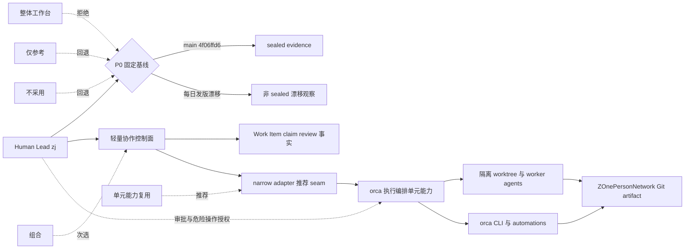
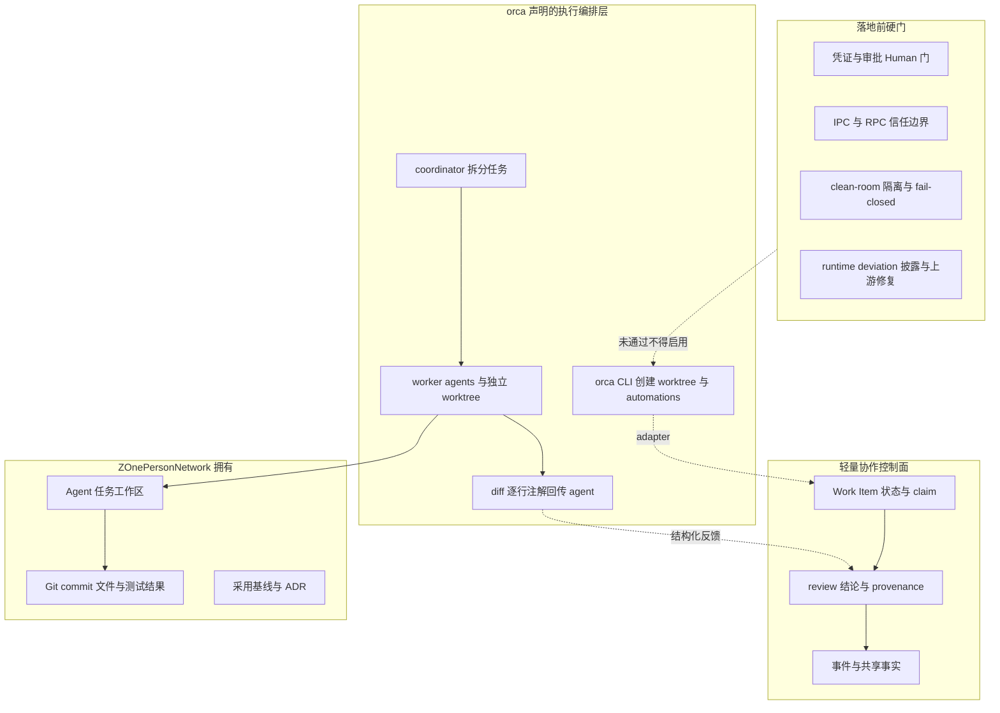
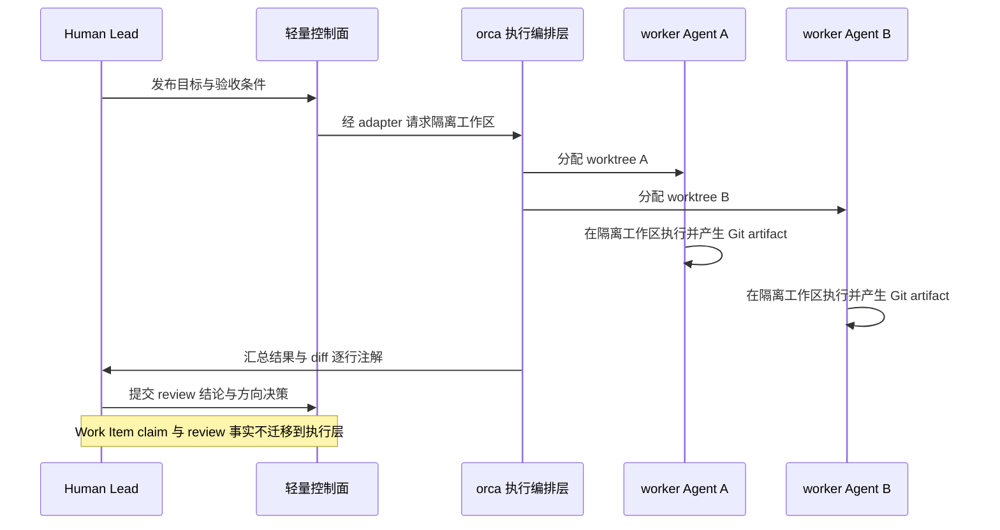

# 调研主题
stablyai/orca 在 ZOnePersonNetwork 的采用决策：执行编排层、单元能力复用还是整体工作台

基于 commit 4f06ffd6 的 sealed evidence，orca 声明的是并行 coding agent 的执行编排与工作台：coordinator 拆分任务、worker 在独立 worktree 执行、CLI 可被 agent 自行驱动、diff 逐行注解回传、并可延伸到 Remote Orca Server / SSH / cloud VM。它没有在 sealed 范围内声明 Work Item、claim、review 这类协作控制面事实的语义所有权，因此与 ZOnePersonNetwork 需要的轻量控制面属于不同层。推荐有条件地「单元能力复用 + 组合」：只吸收 worktree 隔离、coordinator/worker 拆分、CLI 编排与 diff 注解的设计与接口，用 narrow adapter 把控制面事实留在外部；拒绝整体采用为默认工作台。前置条件是固定每日漂移的基线、披露 pinned compiler 的 listTree 运行时偏差、并用 clean-room 实测补齐凭证/审批/隔离与实现层证据。

## 输入材料与观察时间
Evidence ledger: `d0202adfbdd423dcbda38b41d03c0fc8ef513857ea2ccc965667babac3f557e8`
Observed: 2026-11-08T02:36:26.398Z

## Key-Value 概念索引
- Key: `Decision frame（含对齐项）` — zj 只给了仓库 URL，未给决策问题；本报告沿用上一轮 ZAgenticOPN 调研语境，按 alignment 假设其 job 是评估 orca 能否作为 ZOnePersonNetwork 的多 Agent 编排与执行层。基线是空仓库加人工搬运上下文，上一轮控制面候选是 owner-only 的 Experience Version 协调控制面。若真实目标是替换控制面，选项排序需重做。
- Key: `Layer separation` — orca 是执行编排层与工作台：worktree 隔离、coordinator/worker 拆分、CLI 动作面、diff 注解、桌面/移动/远程运行时。Work Item、claim、review 等协作控制面事实是另一层语义，sealed 范围未见 orca 声明拥有它，因此标 unknown 而非 absent；任何让执行层吞掉控制面事实的方案都是语义错配。
- Key: `Fit model` — 按八个维度判语义契合：产品语义、状态/上下文、身份/scope、执行/sandbox、传输/API、可观测、部署、生命周期所有权。每格标 native（源证明直接提供）、adapted（需指定 adapter）、absent（源明确不提供或已退役）、unknown（本轮证据不足）。unknown 永不降级为 absent；stars、topicMatch、README 长度、文件数量永不作为能力分数。
- Key: `Ownership model` — 整体采用 orca 意味着继承 TypeScript/Electron 桌面、mobile、SSH/remote、cloud VM、每日发版、凭证与 telemetry 的升级治理责任。推荐形态下：orca 侧只借用执行单元能力，ZOnePersonNetwork 拥有任务工作区与 Git artifact，轻量控制面拥有 Work Item/claim/review 事实，Human 拥有方向、审批、基线固定与危险操作授权。
- Key: `Lifecycle stage` — Experience Version。只定义一个可丢弃的同设备纵向切片：两个 Agent 在隔离 worktree 并行执行，结果经结构化 diff 注解回传，控制面事实不迁移。不引入 HA、RBAC、SLO、多用户、云 relay 或 dogfood/release 版本偏斜义务；安全主题按执行 Agent 生成代码的要求保留凭证、审批、隔离与恢复门。
- Key: `Evidence boundary` — GitHub 能力结论只引用 commit 4f06ffd6 的 10 条 sealed Evidence ID（9 条 README、1 条 package.json）。SECURITY.md、CONTRIBUTING.md、AGENTS.md、LICENSE 与仓库元数据是明确标注的非 sealed 一手阅读，只用于风险、所有权成本与验证门，不进入 critical claims。
- Key: `Runtime deviation` — pinned compiler（ZHarness 9172aa0）在 orca 的 41,614 项、约 11MB recursive tree 上崩于 listTree 的 response.data.tree.map；本轮使用只修 tree 响应解析的运行时副本完成真实 GitHub 采集，artifact hash 校验被官方 ZJ_RESEARCH_CLI 指针绕过。sealed ledger 仍真实，但 healthy receipt 不等于 pinned artifact 在该仓库可用；上游修复与 lock bump 是未关闭待办。
- Key: `Popularity vs capability` — sealed candidates 记录 stars=118626、topicMatch=0、origin=explicit。热度高、fork 多、topic 多只能说明项目被广泛关注，不能证明语义契合、组合可行性、证据强度或所有权成本；topicMatch=0 只说明关键词与仓库元数据未匹配。
- Key: `Recommendation` — 有条件选择「单元能力复用 + 组合」：以 narrow adapter 复用 worktree 隔离、coordinator/worker、CLI 编排、diff 注解，控制面事实留在轻量控制面；拒绝整体采用为默认工作台。P0 固定基线并披露运行时偏差，P1 clean-room 实测安全与实现层，P2 一个可丢弃纵向切片，P3 复核价值门后再谈阶段晋级。

Concepts: [[Decision frame（含对齐项）]], [[Layer separation]], [[Fit model]], [[Ownership model]], [[Lifecycle stage]], [[Evidence boundary]], [[Runtime deviation]], [[Popularity vs capability]], [[Recommendation]]

## C4 System Landscape
### 决策全景：用户、系统边界、五条选项与被选中的 seam

## 候选项目表
| Repository | Stars | Topic match |
|---|---:|---:|
| stablyai/orca | 118626 | 0 |

## 深读项目卡片
### stablyai/orca（唯一 serious candidate，pin 4f06ffd6）
角色：并行 coding agent 的执行编排器与工作台，不是 Work Item 控制面。最强能力：coordinator 拆分任务、worker 在独立 worktree 执行、agent 可通过 CLI 自建 worktree/启动 worker/调度 automations、diff 逐行注解回传、并可延伸到 Remote Orca Server 与 SSH/cloud VM。主要缺口：sealed 证据只覆盖 README 与 package.json 的声明层；Work Item/claim/review 语义、凭证与审批隔离、实现行为均未获 canonical Evidence，标 unknown 而非 absent；每日发版带来基线漂移；本轮采集还依赖 listTree 修复副本。证据强度：10 条 canonical Evidence、2 个文件、unknownCriteria 为空但覆盖集中，属于「产品意图清晰、落地前必须补证」级别。stars=118626 / topicMatch=0 是 sealed 原值，不作为能力或成熟度信号。

- Claim `c-position`
- Claim `c-worktree-parallel`
- Claim `c-coordinator`
- Claim `c-agent-terminal`
- Claim `c-cli-actions`
- Claim `c-diff-review`
- Claim `c-remote-runtime`
- Claim `c-desktop-install`
- Claim `c-daily-ship`
- Claim `c-license-excerpt-gap`
- Claim `c-privacy-link`
- Claim `c-manifest-tooling`
- Claim `c-evidence-concentration`
- Claim `c-runtime-deviation`
- Claim `c-popularity`
- Claim `c-control-plane-unknown`
- Claim `c-security-unknown`
- Claim `c-ownership-inherited`
- Claim `c-revision-drift`

## 方案族及适用场景对比
### cmp-role-families
角色族：orca 是执行编排层（worktree 隔离、coordinator/worker、CLI 动作面、diff 注解、桌面/远程运行时）；轻量协作控制面是事实层（Work Item、claim、review、事件、provenance）；ZOnePersonNetwork 是消费工作区与 Git artifact；Human 是治理面（方向、审批、基线、危险操作授权）。sealed 证据只证明第一族的产品声明，第二族的所有权在 sealed 范围内保持 unknown。

Claims: `c-position`, `c-worktree-parallel`, `c-coordinator`, `c-cli-actions`, `c-diff-review`, `c-control-plane-unknown`

### cmp-whole-product
约束 ownership-cost 与 lifecycle → 选项「整体采用为默认工作台」→ 证据：远端/SSH/cloud VM 常驻执行、三平台桌面构建、每日发版、README 特性清单永远落后 → tradeoff：一次继承 4 万文件级仓库、Node/Electron 运行时、凭证与 telemetry 治理，且控制面语义仍是 unknown → decision：拒绝。高 stars 不构成抵消这些所有权成本的证据。

Claims: `c-remote-runtime`, `c-desktop-install`, `c-daily-ship`, `c-ownership-inherited`, `c-popularity`, `c-control-plane-unknown`

### cmp-unit-capability
约束 layer 与最小集成面 → 选项「单元能力复用」→ 证据：每个 agent 独立 worktree、coordinator 拆分与结果汇总、CLI 可创建 worktree/启动 worker、diff 逐行注解回传是四个可分离的执行能力 → tradeoff：得到并行隔离与反馈回路，但要自己实现 adapter 与 Human 审批，且不自动获得 Work Item 事实 → decision：推荐，作为纵向切片的能力边界。

Claims: `c-worktree-parallel`, `c-coordinator`, `c-cli-actions`, `c-diff-review`, `c-control-plane-unknown`

### cmp-hybrid
约束控制面事实不迁移 → 选项「orca 执行层 + 轻量控制面组合」→ 证据：orca 的兼容面是终端级 CLI agent，diff 注解能形成结构化反馈 → tradeoff：双系统带来状态翻译、版本匹配与故障归因成本，但能保持所有权清晰 → decision：有条件次选，仅在 narrow adapter 能把 claim/review 事实留在控制面、且双系统日志可关联时采用。

Claims: `c-agent-terminal`, `c-diff-review`, `c-control-plane-unknown`, `c-ownership-inherited`

### cmp-reference-only
约束 evidence → 选项「仅作设计参考」→ 证据：10 条 Evidence 集中在 README 与 package.json，unknownCriteria 为空但实现层、安全层未验证 → tradeoff：零集成风险、可吸收 worktree 隔离与 daily-ship 治理经验，但拿不到并行执行与 diff 回路 → decision：作为 P1 clean-room 门不过时的回退路径。

Claims: `c-evidence-concentration`, `c-security-unknown`, `c-manifest-tooling`

### cmp-no-adoption
约束可验证性与基线 → 选项「不采用」→ 证据：每日发版导致 commit 漂移、pinned compiler 运行时偏差未关闭、凭证/审批/隔离仍 unknown → tradeoff：维持人工交接的已知成本，避免把未验证执行层写进 ZOnePersonNetwork → decision：当 P0 基线无法固定或 P1 安全门失败时立即回退，不追加工程量。

Claims: `c-revision-drift`, `c-runtime-deviation`, `c-security-unknown`

### cmp-capability-matrix
单元能力组合矩阵（cell = 标签 / 集成后 owner）：产品语义 native（并行编排与工作台）/ orca 意图层；状态与上下文 adapted（worktree 与 workspace 需 adapter 映射，控制面事实不迁入）/ Human 与轻量控制面；身份与 scope unknown（sealed 未见统一身份模型）/ zj；执行与 sandbox native（独立 worktree 为声明能力）/ orca 侧但需 Human 审批门；传输与 API native（CLI 动作面与终端级 agent 兼容）/ adapter；可观测性 unknown（只有 telemetry 文档链接与 manifest 脚本，无 sealed 实现证据）/ zj；部署 adapted（三平台桌面 + Homebrew，若采用需独立安装与升级）/ zj；生命周期所有权 native（daily ships 与 changelog 为真实特性清单）/ 上游 orca 维护者。absent 一栏为空：本轮没有 primary source 明确宣告任何上述能力被移除或退役。

Claims: `c-position`, `c-worktree-parallel`, `c-agent-terminal`, `c-cli-actions`, `c-desktop-install`, `c-daily-ship`, `c-privacy-link`, `c-manifest-tooling`, `c-security-unknown`, `c-control-plane-unknown`

### cmp-security
安全与 sandbox 对照：agent 能自行创建 worktree、启动 worker、驱动 desktop apps 与调度 automations（危险操作面），但 sealed 只给出匿名 telemetry 与 opt-out 文档链接；凭证、Human approval、IPC/RPC 信任边界、path injection、隔离与恢复均保持 unknown。因此 P1 必须用 clean-room 实测把「可执行什么」与「允许执行什么」分开，并保持 fail-closed 回执。

Claims: `c-cli-actions`, `c-privacy-link`, `c-security-unknown`, `c-ownership-inherited`

### cmp-ownership-risk
所有权与风险对照：Remote Orca Server / SSH / cloud VM 与笔记本休眠仍运行把执行面延伸到本机之外，diff 注解把反馈结构化但把 review 结论留在 Human，daily ships 把升级节奏交给上游；若整体采用，ZOnePersonNetwork 需要同时承担运行时升级、凭证保留、telemetry opt-out 与跨端故障归因，而报告里没有任何 sealed 证据说明这些责任如何转移。

Claims: `c-remote-runtime`, `c-diff-review`, `c-daily-ship`, `c-ownership-inherited`, `c-security-unknown`

### cmp-evidence-gaps
证据覆盖对照：v1 因 README.md 作为路径关键词把 CI lease 文档错配成安全/工程/review 证据，v2 改用正文短语后 10 条分别命中不同功能段；两轮 unknownCriteria 都为空，但都只覆盖声明层。热度维度另计：stars=118626 / topicMatch=0 是 sealed 原值，MIT 条款、SECURITY.md 信任边界、CONTRIBUTING.md 的 Node 24/pnpm/Vitest 与 AGENTS.md 工程约束均属非 sealed 补充阅读，不能混为 critical claims。

Claims: `c-evidence-concentration`, `c-license-excerpt-gap`, `c-popularity`, `c-runtime-deviation`, `c-manifest-tooling`

### cmp-baseline
约束 baseline → 证据：README 声明 we ship daily，同一天三次观察 main 为三个不同 commit，且本轮采集依赖 listTree 修复副本 → tradeoff：以当前 main 为基线可复现但会很快漂移；固定旧 release 稳定但特性落后 → decision：P0 先把 source_commit、release version 与 runtime deviation 写入 ADR，任何选项在 P0 完成前不进入施工；上游修复后按新 fingerprint 重采。

Claims: `c-daily-ship`, `c-revision-drift`, `c-runtime-deviation`

## C4 Context/Container 与子主题图
### 容器与所有权：执行编排层、控制面、安全门与运行时偏差

### 一次纵向切片的主题流：并行 worktree 到 Human 决策

## 关键技术指标矩阵
| Metric | Definition | Unit | Method | Condition | Expected |
|---|---|---|---|---|---|
| worktree_isolation_violations | 两个并行 Agent 写入同一工作树路径或非各自 worktree 的次数 | 次 | 在 P2 切片中记录每个 Agent 的 workspace root 与 Git 变更路径集合，比对交集 | 每次并行执行与并发竞争窗口都统计 | 0 |
| parallel_agent_conflict_rate | 并行 worktree 合并回控制面时产生冲突、覆盖或人工裁决的运行占比 | % | 按 work_id、revision 与 writer identity 统计冲突事件 | 连续 3 次双 Agent 同构任务 | < 1% 且所有冲突可恢复可审计 |
| provenance_completeness | 结果中带 commit SHA、changed files、test command 与 test result 的 diff 注解完整率 | % | 读取结果引用并与 Git 对象、测试输出逐项核对 | 每个 completed Work Item 至少一次 | 100%，缺任一项即判失败 |
| human_approval_coverage | 创建 worktree、启动 worker、驱动桌面应用、调度 automation 等高风险动作经 Human 显式授权的比例 | % | 审计 CLI 动作日志与授权记录，逐条关联 activation_id 与审批人 | P1 与 P2 全部 Agent 发起动作，含越权负例 | 100%，越权负例必须 fail closed |
| credential_exposure_events | agent-hook token、pairing key、Git 或 provider 凭证出现在非授权进程、host 或页面的次数 | 次 | clean-room 中注入标记凭证并扫描进程环境、IPC/RPC 消息与日志 | P1 安全门与每次 P2 切片 | 0 |
| daily_ship_drift_commits | 被固定为基线的 commit 与当前 main 之间的提交差 | 个 | git rev-parse 与 GitHub compare 接口按 ADR 基线统计 | 每次重采 sealed ledger 前与每次阶段门复核时 | 决策期 0；若大于 0 必须重新固定基线并重采 |
| evidence_concentration_ratio | sealed Evidence 中来自单一文件（README.md）的比例 | % | 按 ledger.evidence 的 path 聚合计数 | 每次采集后复核，跨 ledger 不复用旧结论 | 本次实测 90%；降至 60% 以下并覆盖安全/实现层后才允许进入 dogfood 讨论 |
| adapter_seam_bypass_rate | 执行层绕过 narrow adapter 直接读写控制面事实的运行占比 | % | 关联控制面审计日志、CLI 动作日志与 Git 变更来源 | 所有 P2 Agent run | 0% |
| owner_upgrade_effort_hours | 跟随上游一次 release 完成回归、配置迁移与验证所需的人工小时数 | 小时/版本 | P1/P3 记录每次 release 跟进的实际工时与失败项 | 至少观察 2 个上游 release | ≤ 2 小时/版本，否则整体采用路径不可接受 |
| human_task_specific_interventions | 单个 Work Item 闭环期间 Human 为搬运上下文、review 结论或下一步所做的任务特定介入次数 | 次/任务 | 用统一 Human action 口径记录并人工标注是否任务特定 | 连续 3 个同构任务，与人工基线分开统计 | ≤ 1 且不劣于人工基线，否则价值门保持未闭合 |

## 建议、限制与待验证事项
### rec-primary
总选择：有条件采用「单元能力复用」，并以「组合」作为次选；拒绝把 orca 整体作为 ZOnePersonNetwork 的默认工作台。只吸收四个可分离的执行能力——独立 worktree 隔离、coordinator/worker 拆分与结果汇总、agent 可驱动的 CLI 动作面、diff 逐行注解回传；用 narrow adapter 把它们接到轻量控制面，Work Item / claim / review 事实不迁移。条件一：zj 先固定 source_commit 与 release version 并把 listTree 运行时偏差写进 ADR；条件二：凭证、审批、IPC/RPC 信任边界、隔离与 fail-closed 必须由 clean-room 实测补齐；条件三：验证门不过则退回仅参考或不采用。结论以 sealed commit 4f06ffd6 为界，不把非 sealed 一手阅读写成已验证能力。

Comparisons: `cmp-role-families`, `cmp-whole-product`, `cmp-unit-capability`, `cmp-hybrid`, `cmp-baseline`, `cmp-evidence-gaps`

### rec-constraint-table
约束→选择表（prose）：layer → 控制面事实不迁进执行层；evidence → 能力结论只引用 10 条 sealed Evidence，非 sealed 事实只作风险与验证对象；runtime-deviation → 显式披露修复副本与上游待办，healthy receipt 不冒充 pinned artifact 可用；baseline → 固定 commit 与 release、跨轮指纹不混用；security → agent 自建 worktree/驱动桌面/调度 automations 必须保留 Human 审批、凭证最小权限、隔离与 fail-closed；lifecycle → 只做可丢弃切片，不写 HA/RBAC/SLO/多用户；ownership-cost → 不 fork 4 万文件级仓库、不启用 remote relay 与生产凭证；popularity → stars 与 topicMatch 不参与排序。

Comparisons: `cmp-role-families`, `cmp-capability-matrix`, `cmp-security`, `cmp-baseline`

### rec-phased
分阶段落地：P0 基线对齐——把 4f06ffd6、release version、runtime deviation 与 pinned compiler 上游修复待办写进 ZOnePersonNetwork 的 ADR，并确认决策问题这一 alignment 假设；P1 证据补齐——在 clean-room 安装固定 release，逐项验证 worktree 隔离、CLI 动作审批、凭证边界、diff 注解回路、telemetry opt-out 与 fail-closed 回执，同时让 SECURITY.md / CONTRIBUTING.md / AGENTS.md 成为 canonical Evidence 或单独出 primary-source findings；P2 纵向切片——两个 Agent 在隔离 worktree 并行完成一个 Work Item，采集冲突率、provenance 完整率与 Human 介入次数；P3 价值复核——连续重复实验后对照人工基线决定是否晋级 usefulness-validation，未达标则保持当前阶段或回退。

Comparisons: `cmp-unit-capability`, `cmp-security`, `cmp-evidence-gaps`, `cmp-baseline`

### rec-avoid
应避免的路径：把 orca 源码 fork/vendoring 进 ZOnePersonNetwork；因为 118626 stars 就默认它天然拥有 Work Item/claim/review 控制面语义；把 sealed 范围外的 MIT 条款、SECURITY.md 信任边界、Node 24 工程约束写成已验证能力；把 unknownCriteria 为空解读为安全与实现已验证；在 Experience Version 阶段就铺 remote relay、多用户权限、HA 与生产 SLO；用 README 长度或文件数量做选型排序；用 v1 错配的 CI lease 摘录做安全结论；以及未经 zj 显式确认就安装、commit 或 push。

Comparisons: `cmp-whole-product`, `cmp-evidence-gaps`, `cmp-security`

### rec-risks
剩余风险（与结构化 riskRegister 一致）：① pinned compiler 的 listTree 偏差使 healthy receipt 不等于 pinned artifact 可用；② 每日发版导致同一天三个 main commit 的基线漂移；③ 10 条 Evidence 全来自 README 与 package.json，声明层不等于实现层；④ Work Item/claim/review 语义所有权仍 unknown，执行层可能吞掉控制面事实；⑤ agent 可驱动桌面与调度 automations，凭证、审批、IPC/RPC 边界与 path injection 未验证；⑥ 整体采用会继承桌面/移动/SSH/remote 与 4 万文件级仓库的升级治理；⑦ 双系统组合的状态翻译与故障归因成本。以上每项均有明确机制与 residual owner（Research report owner / zj Human Lead / Pilot operator / ZOnePersonNetwork maintainer），详见 Report IR 的 riskRegister；编译器当前不渲染该结构化字段。

Comparisons: `cmp-ownership-risk`, `cmp-evidence-gaps`, `cmp-security`, `cmp-no-adoption`

### rec-gaps
信息缺口与对齐项：ledger 的 unknownCriteria 为空，因此 informationGaps.status = no-gaps；但这只是账本层面无未决 criterion，仍存在证据覆盖限制——实现层、安全层、控制面语义与许可证条款未进入 sealed 范围，需按 rec-phased P1 复核。另需 zj 确认四个 alignment 假设：真实决策问题、单人同设备单项目边界、是否以 GitHub main 为证据基线、以及是否接受把 orca 定位为执行层而非控制面。缺口闭合前，本报告只支持「有条件采用」而不是阶段晋级结论。

Comparisons: `cmp-evidence-gaps`, `cmp-baseline`, `cmp-no-adoption`

## 来源清单
- [stablyai/orca@4f06ffd66f7b9e8cb78837a91e4f0b4e93f58c7d:README.md](https://github.com/stablyai/orca/blob/4f06ffd66f7b9e8cb78837a91e4f0b4e93f58c7d/README.md) — Evidence `2ed6d70d48ae1d10a19026a0`
- [stablyai/orca@4f06ffd66f7b9e8cb78837a91e4f0b4e93f58c7d:README.md](https://github.com/stablyai/orca/blob/4f06ffd66f7b9e8cb78837a91e4f0b4e93f58c7d/README.md) — Evidence `75e13f823450ea22d6c7f09f`
- [stablyai/orca@4f06ffd66f7b9e8cb78837a91e4f0b4e93f58c7d:README.md](https://github.com/stablyai/orca/blob/4f06ffd66f7b9e8cb78837a91e4f0b4e93f58c7d/README.md) — Evidence `d716c3704d37f7d2b36d2a19`
- [stablyai/orca@4f06ffd66f7b9e8cb78837a91e4f0b4e93f58c7d:README.md](https://github.com/stablyai/orca/blob/4f06ffd66f7b9e8cb78837a91e4f0b4e93f58c7d/README.md) — Evidence `3dc1ea964ea53bfbc291171d`
- [stablyai/orca@4f06ffd66f7b9e8cb78837a91e4f0b4e93f58c7d:README.md](https://github.com/stablyai/orca/blob/4f06ffd66f7b9e8cb78837a91e4f0b4e93f58c7d/README.md) — Evidence `a16d037b586eabaa4c616d4a`
- [stablyai/orca@4f06ffd66f7b9e8cb78837a91e4f0b4e93f58c7d:README.md](https://github.com/stablyai/orca/blob/4f06ffd66f7b9e8cb78837a91e4f0b4e93f58c7d/README.md) — Evidence `0a6cfe851c86d1535e2d2fdc`
- [stablyai/orca@4f06ffd66f7b9e8cb78837a91e4f0b4e93f58c7d:README.md](https://github.com/stablyai/orca/blob/4f06ffd66f7b9e8cb78837a91e4f0b4e93f58c7d/README.md) — Evidence `65802a5a91d96fbb669449e8`
- [stablyai/orca@4f06ffd66f7b9e8cb78837a91e4f0b4e93f58c7d:README.md](https://github.com/stablyai/orca/blob/4f06ffd66f7b9e8cb78837a91e4f0b4e93f58c7d/README.md) — Evidence `17641629769edf434adb6a32`
- [stablyai/orca@4f06ffd66f7b9e8cb78837a91e4f0b4e93f58c7d:README.md](https://github.com/stablyai/orca/blob/4f06ffd66f7b9e8cb78837a91e4f0b4e93f58c7d/README.md) — Evidence `be542a3a9b72fd240e344418`
- [stablyai/orca@4f06ffd66f7b9e8cb78837a91e4f0b4e93f58c7d:package.json](https://github.com/stablyai/orca/blob/4f06ffd66f7b9e8cb78837a91e4f0b4e93f58c7d/package.json) — Evidence `bde86e5bbc69853b1656c85c`
