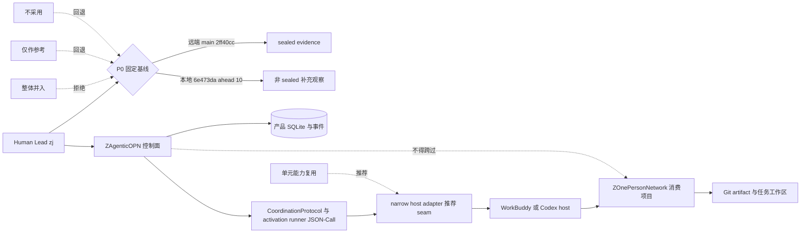
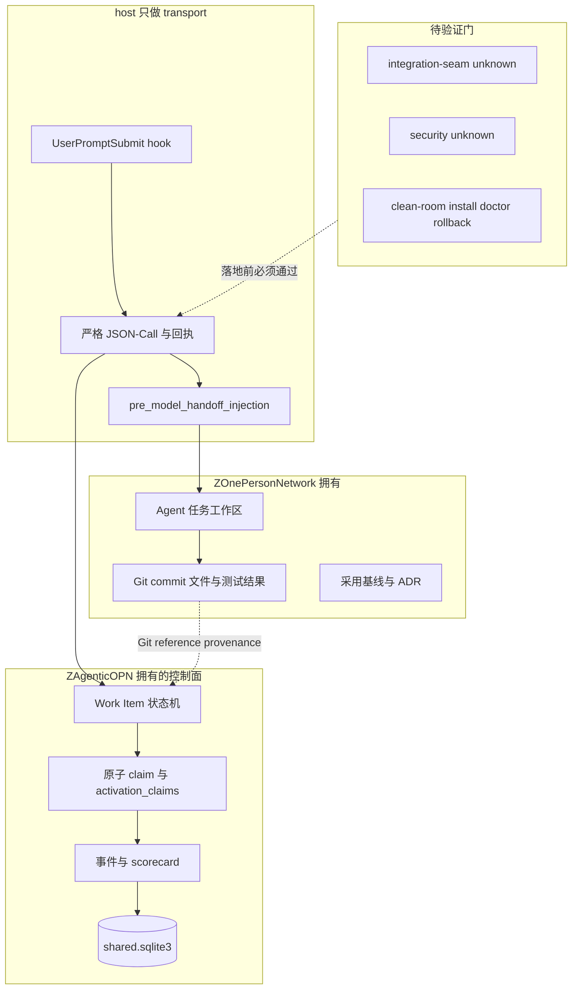
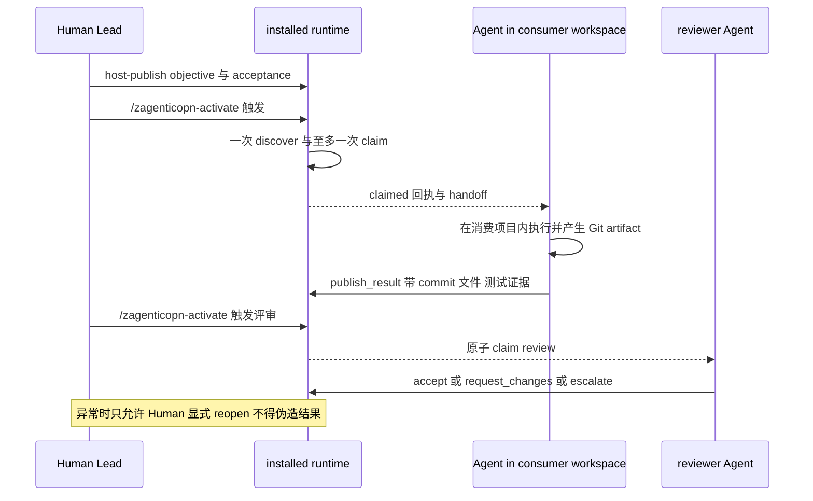

# 调研主题
ZAgenticOPN 在 ZOnePersonNetwork 的采用决策：整体并入、单元能力复用还是仅作参考

基于 commit 2ff40cc 的 sealed evidence，ZAgenticOPN 是一个把 Work Item 共享事实、严格激活 JSON-Call、Human 显式 reopen 与 SQLite 状态所有权收在自身边界内的 Experience Version 控制面。它适合以「单元能力复用」形态经 narrow host adapter 接入 ZOnePersonNetwork，而不适合整体并入消费项目。但本次 sealed 采集有 integration-seam 与 security 两个 unknown criteria，且远端 main 与本地未推送 checkout 存在 10 个 commit 的基线漂移，因此推荐是有条件的：先由 zj 固定基线，再用 clean-room 安装/激活/回滚验证补齐证据，之后才允许一个可丢弃的同设备单项目纵向切片；验证不过则退回仅参考或不采用。

## 输入材料与观察时间
Evidence ledger: `60332d31d8a91b620255d603e775320453c4d7d8ba9ef0b5223b4fb575989160`
Observed: 2026-11-08T02:02:39.669Z

## Key-Value 概念索引
- Key: `Decision frame（含对齐项）` — zj 未给出决策问题，本报告按 alignment 假设其 job 是：判断 ZAgenticOPN 能否以及如何作为 ZOnePersonNetwork 的跨 Agent 协作控制面。基线是空仓库加人工搬运上下文；目标是一个可观测、可丢弃的同设备单项目闭环。若真实目标是跨设备/多用户平台，选项排序需重做。
- Key: `Fit model` — 按八个维度判语义契合：产品语义、状态/上下文、身份/scope、执行/sandbox、传输/API、可观测、部署、生命周期所有权。每格标 native（源证明直接提供）、adapted（需指定 adapter）、absent（源明确不提供或已退役）、unknown（本轮证据不足）。unknown 永不降级为 absent，stars/topicMatch 永不作为能力分数。
- Key: `Ownership model` — ZAgenticOPN 拥有共享 Work Item 事实、claim、review、事件、scorecard 与产品 SQLite；ZOnePersonNetwork 只拥有 Agent 任务工作区与 Git artifact；host adapter 是 transport，不是语义所有者；Human 拥有方向、权限、异常 reopen、基线固定与安装卸载授权。
- Key: `Lifecycle stage` — Experience Version。sealed README 把授权范围收窄为 same-device、single-project vertical slice，deployment、production operations 与 deferred collaboration capabilities 明确 out of scope。本报告不引入 HA、RBAC、SLO、多用户或生产凭证设计，也不产生 dogfood/release 的版本偏斜义务。
- Key: `Evidence boundary` — GitHub 能力结论只引用 pinned commit 2ff40cc 的 6 条 sealed Evidence ID；本地分支 6e473da 的 401 行 README、用户侧 release、v2 intent 等观察显式标为非 sealed 补充事实，只用于风险与对齐，不作能力断言。
- Key: `Baseline drift` — 远端 main = 2ff40cc，sealed 证据里的 intent 是 zagenticopn.activation.check_shared_context.v1；本地 codex/manual-baseline-a = 6e473da 且 ahead 10 未推送，README 已演进到用户侧 release 与 activate.v2。采用前必须二选一固定基线，否则契约、文档与实现三者不一致。
- Key: `Recommendation` — 有条件选择单元能力复用：以 narrow host adapter 调用已安装 runtime 的 activation/claim/handoff/review seam；P0 固定基线，P1 clean-room 补齐 integration/security 证据，P2 一个可丢弃纵向切片，P3 复核价值门后再谈阶段晋级。

Concepts: [[Decision frame（含对齐项）]], [[Fit model]], [[Ownership model]], [[Lifecycle stage]], [[Evidence boundary]], [[Baseline drift]], [[Recommendation]]

## C4 System Landscape
### 决策全景：用户、系统边界、四个选项与被选中的 seam

## 候选项目表
| Repository | Stars | Topic match |
|---|---:|---:|
| jununfly/ZAgenticOPN | 0 | 0 |

## 深读项目卡片
### jununfly/ZAgenticOPN（唯一 serious candidate，pin 2ff40cc）
角色：Human 触发、异构 Agent 自服务协作的 coordination control plane，不是消费项目的库。最强能力：严格版本化 activation JSON-Call、结构化回执、Human 显式 reopen 异常路径，以及把 SQLite/事件/scorecard 收为实现细节的 CoordinationProtocol seam。主要缺口：本轮 sealed 证据未覆盖 install/version matching 与 security 控制，验证证据也只命中设计文档首段；另有远端 main 与本地未推送 checkout 的基线漂移。证据强度：6 条 canonical Evidence、5 个文件、2 个 unknownCriteria，属于「方向可用、落地前必须补证」级别，不足以支持 dogfood 或 release 判断。stars=0 / topicMatch=0 是 sealed 原值，说明它是 owner-only 私有开发仓库，不作为能力或成熟度信号。

- Claim `c-scope`
- Claim `c-lifecycle`
- Claim `c-activation`
- Claim `c-nodb`
- Claim `c-reopen`
- Claim `c-state`
- Claim `c-seam`
- Claim `c-intent-v1`
- Claim `c-host-adapter`
- Claim `c-evidence-concentration`
- Claim `c-integration-unknown`
- Claim `c-security-unknown`
- Claim `c-validation-weak`
- Claim `c-drift`
- Claim `c-popularity`

## 方案族及适用场景对比
### cmp-role-families
角色族：ZAgenticOPN 是控制面（Work Item 状态、claim、review、事件、SQLite）；ZOnePersonNetwork 是消费项目（任务工作区与 Git artifact）；WorkBuddy/Codex 是 transport（hook、JSON-Call、handoff 注入）；Human 是治理面（方向、权限、reopen、基线、安装授权）。sealed 证据把这条分工写在 CoordinationProtocol seam、strict activation 与 Human reopen 三处，任何让消费项目拥有控制面事实的方案都与之冲突。

Claims: `c-seam`, `c-state`, `c-activation`, `c-reopen`, `c-host-adapter`

### cmp-whole-product
约束 decoupling → 选项「整体并入」→ 证据：store/scope 是产品侧输入，activation 请求不携带 DB 路径，SQLite 与事件是实现细节 → tradeoff：并入会让消费项目同时成为控制面 owner，版本升级、schema 迁移、claim 冲突与产品生命周期责任全部内化 → decision：拒绝。sealed README 的 Experience Version 边界进一步说明它当前不是一个可被内联的稳定平台。

Claims: `c-nodb`, `c-state`, `c-seam`, `c-scope`

### cmp-unit-capability
约束 ownership 与最小集成面 → 选项「单元能力复用」→ 证据：唯一公共 seam 是 CoordinationProtocol / activation_runner JSON-Call，host adapter 只解析别名、runner 只接受版本化 intent，回执是结构化状态 → tradeoff：得到 discover/claim/handoff/review 的共享事实，但必须自己承担 host adapter 的严格 JSON、scope binding、版本匹配与失败回执治理 → decision：推荐，且以 clean-room 验证为前置条件。

Claims: `c-activation`, `c-seam`, `c-nodb`, `c-host-adapter`

### cmp-reference-only
约束 evidence 与基线 → 选项「仅作设计参考」→ 证据：边界由 Spec/roadmap 治理，本轮证据集中在设计文档而非可运行产物 → tradeoff：零集成风险、可吸收状态机与 scorecard 方法，但拿不到任何共享 claim 事实 → decision：作为 P0 基线未定或 P1 验证失败时的回退路径，而非首选。

Claims: `c-lifecycle`, `c-evidence-concentration`, `c-validation-weak`

### cmp-no-adoption
约束可验证性 → 选项「不采用」→ 证据：integration-seam/security 为 unknown、验证证据未进入 sealed 范围、远端与本地基线漂移 → tradeoff：维持人工交接的已知成本，但避免把未验证契约写进 ZOnePersonNetwork → decision：当 P1 clean-room 门不过、或 zj 拒绝固定基线时立即回退，不追加工程量。

Claims: `c-integration-unknown`, `c-security-unknown`, `c-validation-weak`, `c-drift`

### cmp-capability-matrix
单元能力组合矩阵（cell = 标签 / 集成后 owner）：产品语义 native / ZAgenticOPN；状态与上下文 native（CoordinationProtocol 与 SQLite）/ ZAgenticOPN；身份与 scope adapted（需用户级 binding 且不得从 cwd 推断）/ Human 与 ZAgenticOPN；执行与 sandbox unknown（sealed 未覆盖消费项目内执行隔离）/ zj；传输与 API native（strict JSON-Call 与回执）/ host adapter；可观测性 unknown（scorecard 只在 sealed 文档中被提为实现细节，未见证据）/ zj 与 Pilot operator；部署 unknown（integration-seam 无 canonical evidence）/ zj；生命周期所有权 native（Experience Version 边界与 Human reopen）/ ZAgenticOPN 与 Human。absent 一栏为空：本轮没有 primary source 明确宣告任何上述能力被移除或退役。

Claims: `c-state`, `c-activation`, `c-seam`, `c-reopen`, `c-integration-unknown`, `c-security-unknown`, `c-validation-weak`

### cmp-ownership-risk
所有权与风险对照：Human reopen 把异常恢复留在治理面，避免 Agent 伪造结果，但也意味着没有自动 retry/claim TTL 的兜底；状态与事件留在产品 SQLite 保证单一事实源，却让 ZOnePersonNetwork 的故障排查依赖产品侧可观测能力；而 integration/security 的 unknown 与基线漂移意味着「集成后谁负责升级、回滚、数据保留」尚未由 sealed 证据回答，必须在 P1 用可复核产物指定 owner。

Claims: `c-reopen`, `c-state`, `c-integration-unknown`, `c-security-unknown`, `c-drift`

### cmp-evidence-gaps
证据覆盖对照：本轮 6 条 Evidence、2 个文件、2 个 unknownCriteria；三次采集（v1/v2/v3）都未把 install_release.py、Uninstall.command、tests 或 scorecard 选为 canonical evidence，因此不能据此判断这些能力 absent。热度维度另计：stars=0 / topicMatch=0 只是 sealed 原值，与语义契合、组合可行性、证据强度、所有权成本四个评分轴完全分离。

Claims: `c-evidence-concentration`, `c-integration-unknown`, `c-security-unknown`, `c-popularity`, `c-validation-weak`

### cmp-baseline
约束 baseline → 证据：sealed 基线的 intent 是 check_shared_context.v1，而远端 README 仅 10 行、本地 checkout 已是另一套交付形态 → tradeoff：以远端为基线可复现但契约旧；以本地为基线功能新但第三方无法复现且未推送 → decision：把「固定 commit / release 并把基线写入 ADR」设为 P0，任何选项在 P0 完成前都不进入施工。

Claims: `c-intent-v1`, `c-drift`, `c-scope`, `c-lifecycle`

## C4 Context/Container 与子主题图
### 容器与所有权：控制面、消费项目、host 与验证边界

### 一次纵向切片的主题流：从显式发布到评审完成

## 关键技术指标矩阵
| Metric | Definition | Unit | Method | Condition | Expected |
|---|---|---|---|---|---|
| activation_contract_conformance | 激活 JSON-Call 字段集合、intent 版本与结构化回执类型符合固定基线契约的运行占比 | % | 对每次 host-activate 记录请求字段与回执状态，和 ADR 中的 pinned contract 逐字段比对 | P1 clean-room 与 P2 纵向切片的每一次激活，失败与成功都计入 | 100%，任何 invalid_contract 或 unsupported_host 都算不达标 |
| claim_uniqueness | 单次 activation_id 实际产生的 claim 次数 | 次/激活 | 用 activation_claims 主键与 events 表按 activation_id 做去重计数 | 含并发竞争窗口与 claim_conflict 场景 | ≤ 1，且冲突场景返回 claim_conflict 不重试 |
| scope_resolution_explicit_rate | scope 来自显式输入或用户级 workspace binding、而非 cwd/Git remote/项目文件推断的比例 | % | 审计 host adapter 的 scope 解析路径并注入无 binding 与歧义 binding 的负例 | P1 与 P2 全部激活运行，含 scope_unbound 负例 | 100%，负例必须 fail closed 且返回 scope_unbound |
| result_provenance_completeness | publish_result 中带 commit SHA、changed files、test command 与 test result 的 Git reference 完整率 | % | 读取结果引用并与 Git 对象及测试输出逐项核对 | 每个 completed Work Item 至少一次 | 100%，缺任一项即判失败 |
| consumer_decoupling_violations | ZOnePersonNetwork 内出现 import zagentic_opn、PYTHONPATH 注入或产品 SQLite 文件/路径的次数 | 次 | CI 静态扫描加运行时环境变量审计，按文件与提交记录命中 | P2 每次提交与每次激活 | 0 |
| clean_room_gate_pass_rate | clean-room 安装、doctor、激活 smoke、rollback、keep-data uninstall 五项验证通过率 | % | 在隔离用户目录执行固定命令链并保存 JSON 回执与日志 | 固定基线后、P2 开始前 | 100%，未通过则维持仅参考或不采用 |
| baseline_drift_commits | 被选为采用基线的远端 commit 与本地工作分支 HEAD 之间的未推送 commit 数 | 个 | git log --oneline main..HEAD 与 git rev-parse HEAD 对比，并核对 release manifest 的 source_commit | P0 决策时与每次重采 sealed ledger 前 | 0，或明确记录差异并重新采集证据 |
| evidence_coverage_rate | sealed ledger 中获得 canonical Evidence 的 critical criterion 占比 | % | 用 8 个 brief criteria 减去 unknownCriteria 后除以 8 | 每次采集后复核，跨 ledger 不复用旧结论 | 100% 才允许进入 dogfood 讨论；本次实测 75% 且 informationGaps=has-gaps |
| human_task_specific_interventions | 单个 Work Item 闭环期间 Human 为搬运任务上下文、review 结论或下一步所做的任务特定介入次数 | 次/任务 | 用统一 Human action 提取口径记录 role=user 动作，人工标注是否任务特定 | 连续 3 个同构任务，与人工方案 A 基线分开统计 | ≤ 1 且相对人工基线不劣，否则价值门保持 NOT PROVEN |

## 建议、限制与待验证事项
### rec-primary
总选择：有条件采用「单元能力复用」，不采用「整体并入」。ZOnePersonNetwork 以 narrow host adapter 调用已安装 runtime 的 activation/claim/handoff/review seam，消费项目只保留任务工作区与 Git artifact；控制面事实、事件、scorecard 与 SQLite 继续由 ZAgenticOPN 拥有。条件一：zj 先固定基线（远端 main 2ff40cc 或本地 6e473da 对齐后重采）；条件二：integration-seam 与 security 两个 unknown 必须由 clean-room 可复核产物补齐；条件三：验证门不过则退回仅参考或不采用。本结论以 sealed commit 2ff40cc 为界，不把本地未推送实现当作能力证据。

Comparisons: `cmp-role-families`, `cmp-whole-product`, `cmp-unit-capability`, `cmp-baseline`, `cmp-evidence-gaps`

### rec-constraint-table
约束→选择表（prose）：lifecycle → 只做 Experience Version 可丢弃切片，不写 HA/RBAC/SLO；ownership → 控制面事实留 ZAgenticOPN，ZOnePersonNetwork 不建第二份任务状态；decoupling → 禁止 import、PYTHONPATH 与产品 SQLite 落进消费项目，用 CI 检查守住；activation → 严格 JSON-Call 与一次 discover/至多一次 claim，禁止轮询重试；scope → 只接受显式或用户级 binding，禁止从 cwd/Git remote 推断；evidence → 能力结论只引用 sealed Evidence ID，本地观察标为非 sealed；security → 安装/卸载/版本切换保留 Human 确认与 fail-closed，未验证项不默认 native；baseline → 先固定 commit 再谈接入。

Comparisons: `cmp-role-families`, `cmp-capability-matrix`, `cmp-baseline`

### rec-phased
分阶段落地：P0 基线对齐——由 zj 决定采用 commit，把 source_commit、release_id 与 intent 版本写入 ZOnePersonNetwork 的 ADR，必要时先合并/推送本地 10 个 commit 并重采 sealed ledger；P1 证据补齐——用正式 release bundle 在 clean-room 用户目录跑 Install.command、doctor、一次激活 smoke、rollback 与 keep-data uninstall，逐项记录回执与 checksum/Human 确认结果，使 unknown_criteria_count 归零；P2 纵向切片——一个 Work Item 走完 publish→activate→claim→publish_result→review→completed，采集 decouple 违规、provenance 完整性与 Human 介入次数；P3 价值复核——连续重复实验后对照人工基线决定是否晋级 usefulness-validation，未达标则保持 Experience Version 或回退。

Comparisons: `cmp-baseline`, `cmp-unit-capability`, `cmp-evidence-gaps`

### rec-avoid
应避免的路径：把 ZAgenticOPN checkout 复制/submodule 进 ZOnePersonNetwork；让消费项目直接读写 shared.sqlite3；用本地未推送的 401 行 README 作为第三方可复核证据；把 integration-seam/security 的 unknown 写成已实现或明确缺失；在 Evidence Version 阶段就铺多用户权限、跨设备同步、自动发现、HA 与生产 SLO；用 stars/topicMatch 或文件数量做选型排序；以及未经 zj 显式确认就 commit/push 或执行安装卸载。

Comparisons: `cmp-whole-product`, `cmp-evidence-gaps`, `cmp-ownership-risk`

### rec-risks
剩余风险（与结构化 riskRegister 一致）：① 远端 main 与本地 ahead 10 未推送 commit 的基线漂移，可能导致 host/runtime 契约不一致；② integration-seam 未验证，首次激活可能返回 scope_unbound、unsupported_host 或 handoff 失败；③ security 控制未验证，安装/卸载/版本切换可能误改用户数据或 host 注册；④ 所有权渗透，手工调试绕过 adapter 直接读产品 SQLite；⑤ Human 仍需跨 host 搬运 review 结论，价值门可能无法闭合；⑥ 证据覆盖不足，把 unknown 误读为已具备能力。以上每项均有明确机制与 residual owner（Human Lead / Pilot operator / ZOnePersonNetwork maintainer / Research report owner），详见报告 IR 的 riskRegister，编译器当前不渲染该结构化字段。

Comparisons: `cmp-ownership-risk`, `cmp-evidence-gaps`, `cmp-no-adoption`

### rec-gaps
信息缺口与对齐项：ledger 的 unknownCriteria 为 integration-seam 与 security，informationGaps.status = has-gaps；6 条 Evidence 集中于 2 个文件，测试与 scorecard 结论未进入 sealed 范围；远端与本地版本基线漂移属未验证项。另需 zj 确认三个 alignment 假设：真实决策问题、是否确实需要单人同设备多 Agent 控制面、是否以 GitHub main 为证据基线。在缺口闭合前，本报告只能支持「有条件采用」而不是阶段晋级结论。

Comparisons: `cmp-evidence-gaps`, `cmp-baseline`, `cmp-no-adoption`

- Unknown: jununfly/ZAgenticOPN / integration-seam
- Unknown: jununfly/ZAgenticOPN / security

## 来源清单
- [jununfly/ZAgenticOPN@2ff40cc052aae12fc7a324f89691e9f194985d24:README.md](https://github.com/jununfly/ZAgenticOPN/blob/2ff40cc052aae12fc7a324f89691e9f194985d24/README.md) — Evidence `24c521a1983ee68dafa9544d`
- [jununfly/ZAgenticOPN@2ff40cc052aae12fc7a324f89691e9f194985d24:README.md](https://github.com/jununfly/ZAgenticOPN/blob/2ff40cc052aae12fc7a324f89691e9f194985d24/README.md) — Evidence `0b78ab7e1b5659a7c049d4f6`
- [jununfly/ZAgenticOPN@2ff40cc052aae12fc7a324f89691e9f194985d24:docs/experience-version-coordination.md](https://github.com/jununfly/ZAgenticOPN/blob/2ff40cc052aae12fc7a324f89691e9f194985d24/docs/experience-version-coordination.md) — Evidence `4132ea9292deeab3cf164ca5`
- [jununfly/ZAgenticOPN@2ff40cc052aae12fc7a324f89691e9f194985d24:docs/experience-version-coordination.md](https://github.com/jununfly/ZAgenticOPN/blob/2ff40cc052aae12fc7a324f89691e9f194985d24/docs/experience-version-coordination.md) — Evidence `53ce90d514f1eb59d753635b`
- [jununfly/ZAgenticOPN@2ff40cc052aae12fc7a324f89691e9f194985d24:docs/experience-version-coordination.md](https://github.com/jununfly/ZAgenticOPN/blob/2ff40cc052aae12fc7a324f89691e9f194985d24/docs/experience-version-coordination.md) — Evidence `b006b887f99616e81bf87d09`
- [jununfly/ZAgenticOPN@2ff40cc052aae12fc7a324f89691e9f194985d24:docs/experience-version-coordination.md](https://github.com/jununfly/ZAgenticOPN/blob/2ff40cc052aae12fc7a324f89691e9f194985d24/docs/experience-version-coordination.md) — Evidence `ce263a867539ddd51588ed09`
